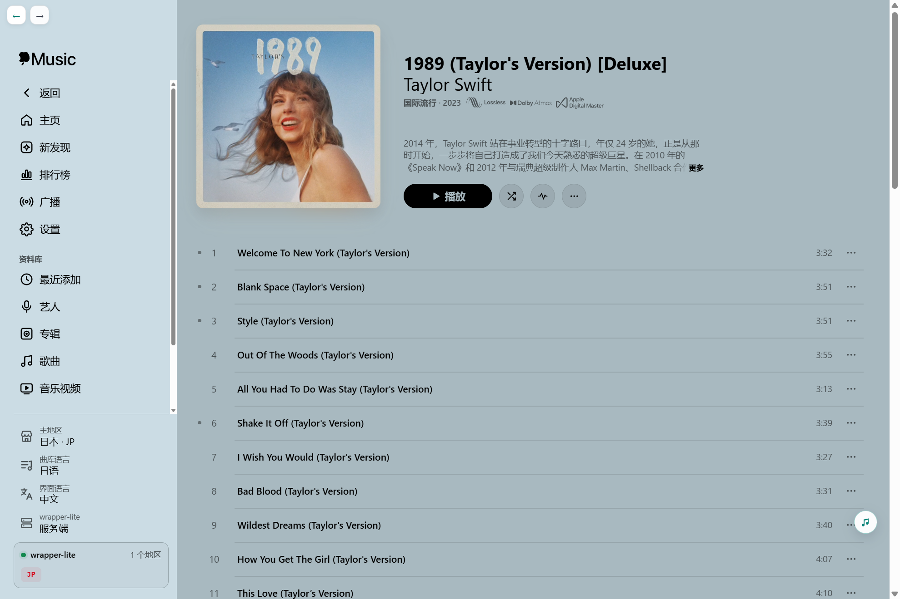
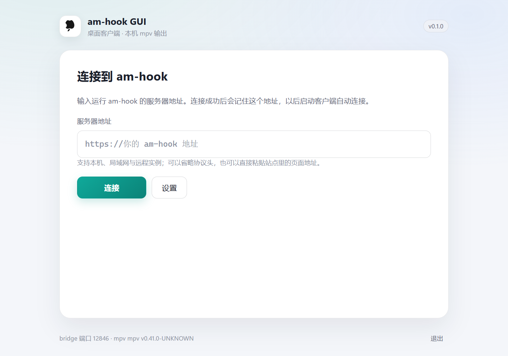
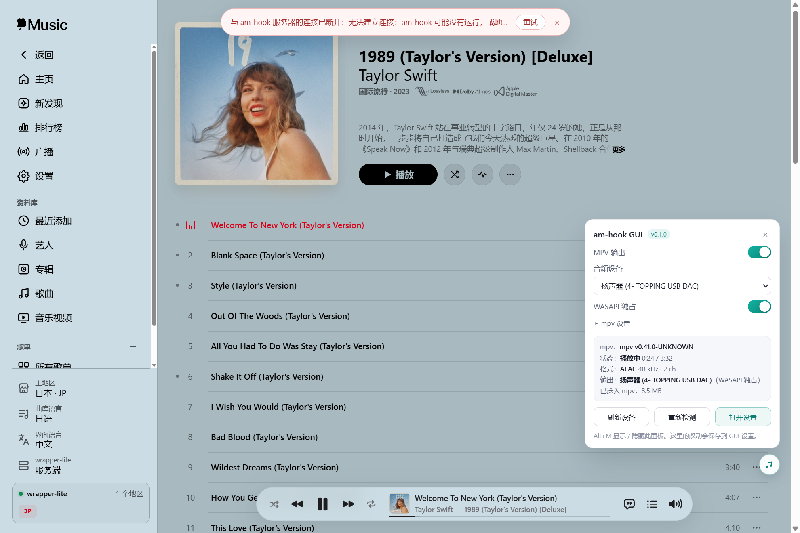
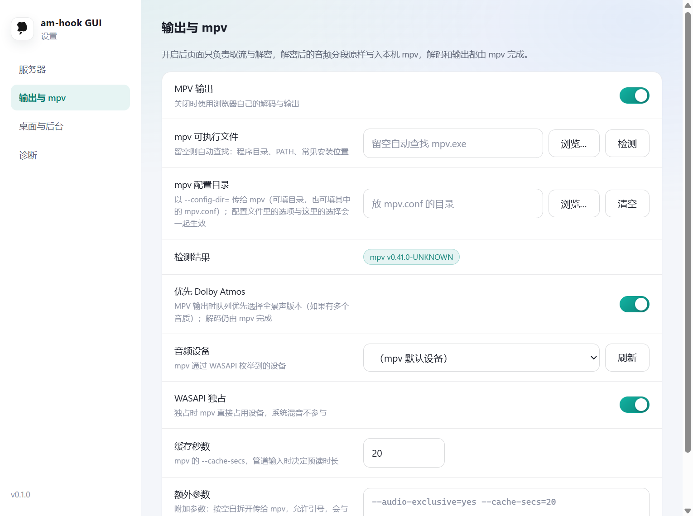

# am-hook GUI

Windows 桌面客户端，用 WebView2 打开自建的 am-hook 网页，并可以把播放交给本机 mpv。

客户端不修改页面：搜索、专辑、队列、歌词、音质切换都还是 am-hook 自己的界面。它只做三件事：
开窗口、把解密后的音频交给 mpv、处理托盘与设置这些桌面侧的事情。
因此任意一个带浏览器内解密的 am-hook 实例都能直接连，服务端不需要装任何插件。



## 功能

- **加载原页面**：主窗口就是 am-hook 页面，站内跳转留在窗口里，外部链接交给系统浏览器。
- **本机 mpv 输出**：页面只负责取流与解密，音频分段原样送入 mpv 的 stdin，
  解码、重采样和输出全部由 mpv 决定。客户端不解析音频格式，也不假设 mpv 支持哪些编码。
  找不到 mpv 或关掉这个选项时，用页面自己的浏览器输出。
- **音频设备与独占**：从 mpv 的 `audio-device-list` 枚举 WASAPI 设备，可指定设备、开关独占。
  界面里选的设备在参数中放在最后，不会被配置文件或额外参数覆盖。
- **播放控制**：播放、暂停、seek、切歌、音量都与页面同步；seek 时如果管道里还没有目标数据，
  会从目标位置重开一次会话。
- **桌面行为**：默认关窗即退出并结束 mpv；可改成收进托盘继续播放。另有最小化到托盘、
  启动时隐藏、后台播放优化、窗口大小与位置记忆、单实例。
  GUI 被任务管理器强杀时，mpv 会随作业对象一起结束，不会留下占着独占设备的进程。
- **页面存储持久化**：页面自己的设置是 WebView2 profile 里的 localStorage / IndexedDB，
  固定在 `%LOCALAPPDATA%\moe.amhook.gui\webview2`，换 exe 位置或清空配置目录都不影响。
- **连接管理**：连接前检查目标确实是 am-hook，成功后记住地址并自动连接；
  运行中每 8 秒探活，服务器断开时页面顶部出现横幅，恢复后自动消失。
- **页面内悬浮面板（Alt+M）**：切换输出方式、选设备、开关独占、直接选 mpv 可执行文件和配置目录、
  重新检测 mpv、查看当前状态。窗口左上角有后退 / 前进按钮。
- **诊断**：设置 → 诊断里可以看到版本、路径、bridge 端口、最近 300 行日志，
  以及托盘图标是否真的被系统接收。

## 系统要求

| 组件 | 要求 |
| --- | --- |
| 系统 | Windows 10 1809+ / Windows 11（x64），需要 WebView2 运行时 |
| 服务器 | 任意可访问的 am-hook 实例（本机、局域网或远程），需要带浏览器内解密（`/assets/decrypt.js` 提供 `AmDecrypt.openTrack`） |
| 播放器 | 可选。要用 mpv 输出时需要一份 `mpv.exe`，建议用较新的版本（需要 JSON IPC 与 `--audio-exclusive`） |

mpv 的查找顺序是：设置里指定的路径 → `AM_HOOK_GUI_MPV` 环境变量 → 程序目录 → `PATH`
→ 常见安装位置（scoop、`%LOCALAPPDATA%\Programs\mpv`、`Program Files\mpv`、`C:\mpv`、`C:\Tools\mpv`）。
都不合适就在设置里选一下，路径可以随时改。

## 安装与首次连接

1. 运行安装包 `am-hook-GUI_0.1.0_x64-setup.exe`，或者直接运行免安装的 `am-hook-gui.exe`。
   安装包按当前用户安装，覆盖文件前会先结束正在运行的实例。

   

2. 填服务器地址，例如 `http://127.0.0.1:8888`、`http://192.168.1.10:8888` 或 `https://music.example.com`。
   `http://` 可以省略，也可以直接粘贴站点里的页面地址，客户端只会取站点根。

3. 点「连接」。客户端会检查：

   - `/` 返回 am-hook 的单页外壳；
   - `/assets/host.js` 里有 `AM_HOOK_HOST`；
   - `/assets/decrypt.js` 里有 `openTrack`（太旧的版本没有浏览器内解密，会直接拒绝）。

4. 检查通过后打开主窗口并记住地址，下次启动自动连接。失败时窗口会给出原因和「重试 / 修改地址」。
   连接过的地址会出现在「最近连接」里。

运行中服务器挂掉时，页面顶部会显示断线横幅，恢复后自动消失：



## 设置

设置窗口可以从托盘菜单、连接窗口的「设置」或悬浮面板的「打开设置」进入。

### 服务器

显示当前连接状态与地址，可连接 / 切换、重新连接、断开。「最近使用」列出连接过的地址。

### 输出与 mpv



| 项目 | 说明 |
| --- | --- |
| MPV 输出 | 默认开启。关闭后使用页面自己的浏览器输出 |
| mpv 可执行文件 | 留空自动查找；可以浏览选择，也可以直接填路径。自动找到的路径只显示在状态里，不会写进输入框 |
| mpv 配置目录 | 以 `--config-dir=` 传给 mpv，可填目录或其中的 `mpv.conf`。该文件里的选项与界面上的选择一起生效 |
| 检测结果 | 找到的 mpv 版本 |
| 优先 Dolby Atmos | mpv 输出时，队列如果有多个音质可选，优先挑全景声版本；解码仍由 mpv 完成。默认开启 |
| 音频设备 | 从 mpv 枚举到的设备里选；留空为 mpv 默认设备 |
| WASAPI 独占 | 开启时加 `--ao=wasapi --audio-exclusive=yes`。独占会占用整个设备，其他程序无法同时出声 |
| 缓存秒数 | `--cache-secs`，管道输入时的预读时长，默认 20 秒 |
| 额外参数 | 追加到参数末尾；按空白拆开，支持引号。`--script`、`--include` 等能执行代码的选项会被拒绝 |

### 桌面与后台

- **关闭窗口时收进托盘**：默认关闭（关窗即退出并停止播放）。打开后关窗只是隐藏窗口，音频继续。
- **托盘菜单**：打开主页面、设置、退出，以及切换 MPV 输出、重新连接、更换服务器；左键单击图标显示或隐藏主窗口。
- **最小化时收进托盘**：最小化直接隐藏任务栏按钮。
- **启动时隐藏窗口**：只留托盘图标；连接失败时仍会弹出连接窗口。
- **后台播放优化**：给 WebView2 加禁止定时器降频和遮挡挂起的启动参数（下次连接生效）。
- **把局域网 http 当作安全上下文**：对 `http://192.168.x.x` 之类的地址使用 Chromium 的
  `--unsafely-treat-insecure-origin-as-secure`，让需要安全上下文的功能（例如离线下载）可用
  （下次连接生效）。

### 诊断

显示版本、服务器、bridge 端口、mpv 路径与版本、当前会话、配置目录、数据目录、页面存储目录、
托盘图标状态，以及最近 300 行运行日志。日志同时写入数据目录下的 `gui.log`。

## mpv 配置

界面上的设备、独占、缓存已经够用。想复用现成的 `mpv.conf`（里面可能有 HRTF、滤波或渲染参数）时，
把目录填到「mpv 配置目录」。参数是按顺序拼接的：

```text
--config-dir=<配置目录> --ao=wasapi --audio-exclusive=yes --audio-samplerate=0
--cache-secs=<秒数> --demuxer-max-bytes=512MiB <额外参数…> --audio-device=<界面选的设备>
```

其中 `--config-dir` 只在指定了配置目录时出现，`--audio-samplerate=0` 只在独占时出现。
后出现的同名选项生效，所以：

- 每项设置各自生成参数，互不替换；额外参数只追加。
- 设备参数固定放最后，界面里选的设备一定生效。
- 想覆盖别的选项就在额外参数里再写一遍；唯独设备以界面选择为准。

## 工作原理

```text
am-hook 页面（WebView2）
  ├─ AmDecrypt.openTrack()      取流 + 浏览器内解密
  ├─ 注入脚本 MpvEngine         分段 POST 给本机 bridge
  └─ 播放器补丁                  mpv 模式下播放控制与进度显示接到 mpv

本机 bridge（Tauri 进程内，127.0.0.1:随机端口）
  ├─ /mpv/play|feed|control|state|session|devices
  ├─ /events                    SSE：mpv 状态、配置变化、服务器状态
  └─ 每会话 250 ms 轮询 mpv 的 JSON IPC

mpv（独立进程，stdin 收数据）
  └─ 自己解码并输出到 WASAPI
```

几个设计上的选择：

- **为什么用本机 HTTP 而不是 Tauri IPC**：音频是长连接加背压，HTTP 请求体天然能表达
  「mpv 没读完就不要发下一段」；页面还能用 `EventSource` 收状态，窗口隐藏时不受页面定时器降频影响。
- **为什么一段一次 POST**：WebView2 里带 `ReadableStream` 请求体的 `fetch` 会失败
  （`net::ERR_ALPN_NEGOTIATION_FAILED`），普通 POST 稳定。bridge 写完 mpv 的 stdin 才响应，
  背压照样成立。
- **状态走 SSE**：位置、时长、暂停、解码器、实际输出设备由 bridge 推给页面，
  后台被降频时也能按时收到「播完了」，队列因此能自动下一首。
- **两路声音只会有一路**：切到 mpv 之前先拆掉页面自己的 MSE / Web Audio / `<audio>`，
  切回浏览器之前先停掉 mpv 会话。
- **安全**：bridge 只绑定 `127.0.0.1`，每次启动生成随机令牌，只注入给页面脚本；
  mpv 参数会做校验，挡住能执行代码的选项。

## 从源码构建

需要 Rust stable（MSVC 工具链）、Node.js 20+、Visual Studio 2022 生成工具和 WebView2 运行时。

```bat
npm install
npm run tauri build                  :: 生成 exe 和 NSIS 安装包
npm run tauri build -- --no-bundle   :: 只生成 exe
```

产物在 `src-tauri/target/release/am-hook-gui.exe` 和
`src-tauri/target/release/bundle/nsis/am-hook GUI_0.1.0_x64-setup.exe`。

> 第一次打包时 Tauri 会从 GitHub 下载 NSIS 3.13 和 `nsis_tauri_utils.dll`。
> 网络受限时可以手动放到 `%LOCALAPPDATA%\tauri\NSIS\`：解压 `nsis-3.13.zip` 得到
> `NSIS/Bin/makensis.exe`，插件放到 `NSIS/Plugins/x86-unicode/additional/nsis_tauri_utils.dll`。

开发时用 `npm run tauri dev`。

## 测试

单元测试：

```bat
cd src-tauri
cargo test
```

`scripts/e2e.mjs` 是端到端测试，通过 DevTools 协议驱动真实的 WebView2 窗口，
需要 GUI 以调试参数启动，并且有一个可访问的 am-hook 实例：

```bat
set AM_HOOK_GUI_CDP=9222
set AM_HOOK_GUI_DEBUG_BRIDGE=1
set AM_HOOK_GUI_DATA_DIR=C:\am-hook-gui-data
src-tauri\target\debug\am-hook-gui.exe

node scripts\e2e.mjs --base http://127.0.0.1:8888 --device "你的输出设备"
```

`--device` 是设备名或 id 里的一段文字，用来固定测试输出（避免占用系统默认设备）；
也可以用 `AM_HOOK_GUI_TEST_DEVICE` 设置。脚本会依次验证连接、注入、设备选择、播放与暂停、
seek、切歌、后退、歌词、后台播放，以及浏览器输出与 mpv 之间的切换。脚本里用到的专辑和音质
是固定测试数据，需要服务器端有对应的内容。

`scripts/cdp.mjs` 是个小工具，可以在 GUI 开着时从命令行查看目标和执行表达式：

```bat
node scripts\cdp.mjs targets
node scripts\cdp.mjs eval --url 127.0.0.1:8888 --expr "window.__AM_HOOK_GUI__.snapshot()"
```

## 文件与环境变量

配置和数据默认在 `%APPDATA%\moe.amhook.gui`，页面存储在 `%LOCALAPPDATA%\moe.amhook.gui\webview2`。

| 变量 / 文件 | 作用 |
| --- | --- |
| `AM_HOOK_GUI_DATA_DIR` | 指定数据目录（配置、日志） |
| exe 旁的 `portable.txt` | 便携模式，数据写到 `exe\data` |
| `AM_HOOK_GUI_WEBVIEW_DIR` | 指定 WebView2 的 profile 目录 |
| `AM_HOOK_GUI_MPV` | 指定 mpv 路径，等价于在设置里填 |
| `AM_HOOK_GUI_LOG` | 日志过滤（默认 `info,am_hook_gui=debug`） |
| `AM_HOOK_GUI_CDP` | 打开 WebView2 的调试端口，仅供测试 |

## 常见问题

**提示「这个网页不是 am-hook」**
确认填的是站点根，例如 `http://127.0.0.1:8888`，而不是 `.../assets/app.html`。

**提示「太旧，没有浏览器内解密」**
该版本的 am-hook 没有 `AmDecrypt`（`/assets/decrypt.js` 里没有 `openTrack`），无法把音频交给 mpv，
需要升级服务器。

**连接时提示 Cloudflare 人机验证**
目标站点的 Cloudflare 把客户端的检查请求当成机器人，返回了验证页，服务端本身是正常的。
确认地址是你的 am-hook 后，点「仍然继续」在打开的页面里完成验证即可；连接成功一次后，
以后启动会自动打开页面，不再重复提示。
长期使用也可以在 Cloudflare 对 `/`、`/assets/*`、`/status` 关闭挑战或加放行规则。

**没有声音 / 独占失败**
看设置里的日志，mpv 异常退出时会带上它的 stderr。常见原因是设备被别的程序独占、
设备 id 在重新插拔后变了（点「刷新」重选），或者额外参数里的 `--ao` 改坏了输出。

**托盘图标不见了**
Windows 11 默认把新图标收进任务栏右下角的 `^` 折叠区，想常驻就从里面拖到任务栏。
如果设置 → 诊断里「托盘图标」显示系统没有接收，通常是进程权限被降级（例如从受限目录或沙箱启动），
把 exe 放到普通用户目录再运行即可。此时关闭窗口会退化成最小化，不会让程序直接消失。

**关窗后还在放**
检查是否打开了「关闭窗口时收进托盘」；关闭该选项后关窗会退出并结束 mpv。

## 已知限制

- mpv 输出只对本机页面开放：bridge 绑定回环地址并校验随机令牌，远程机器上的页面拿不到令牌。
- 每首歌会重启一次 mpv（约 0.2–0.4 秒起播），换取干净的独占会话。
- seek 依赖管道缓存：目标位置不在缓存里时会重开会话，有一次短暂停顿。
- 客户端不探测 mpv 的能力，也不判断它支持哪些编码；能不能播由 mpv 自己决定。
- `--config-dir` 指向的 `mpv.conf` 属于本机可信文件；`--script`、`--include` 这类能执行代码的
  参数仍然会被拒绝。

## 许可证

与 am-hook 一致：AGPL-3.0-only。
