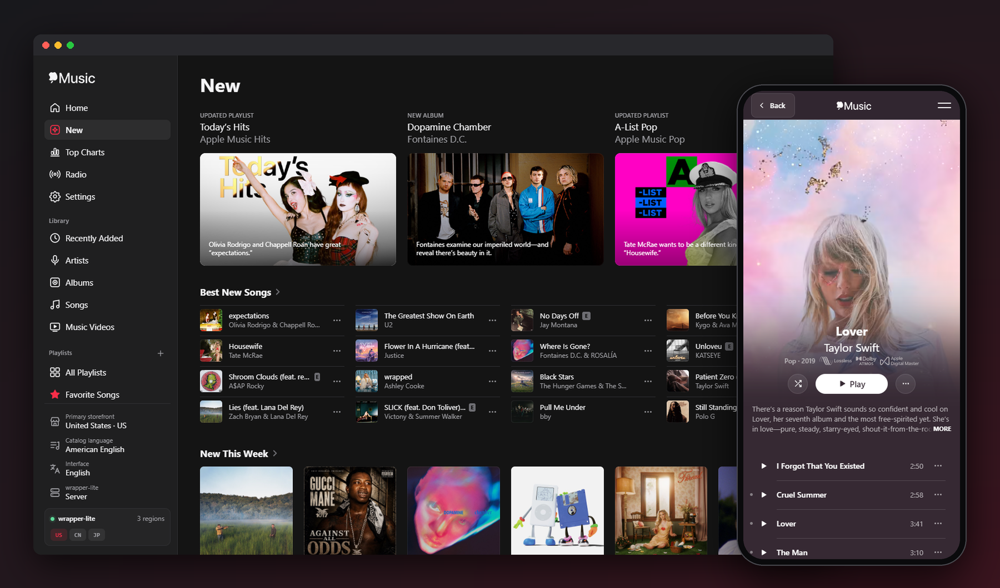
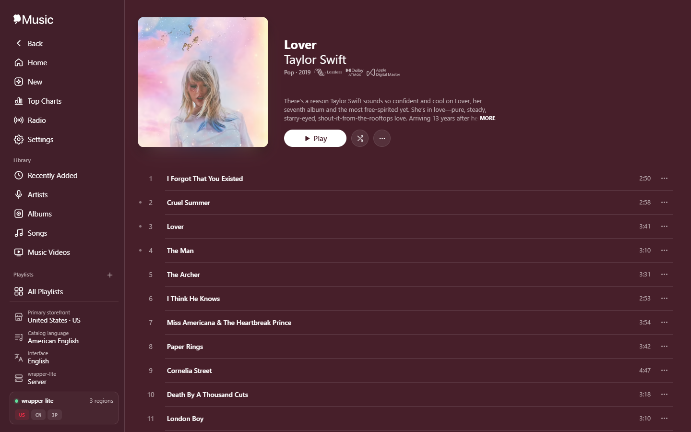
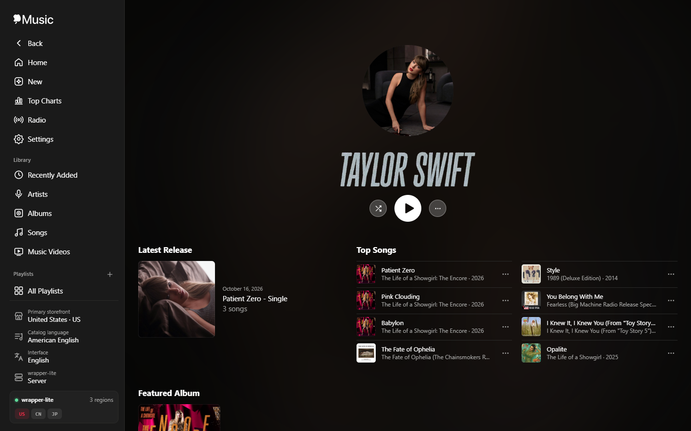
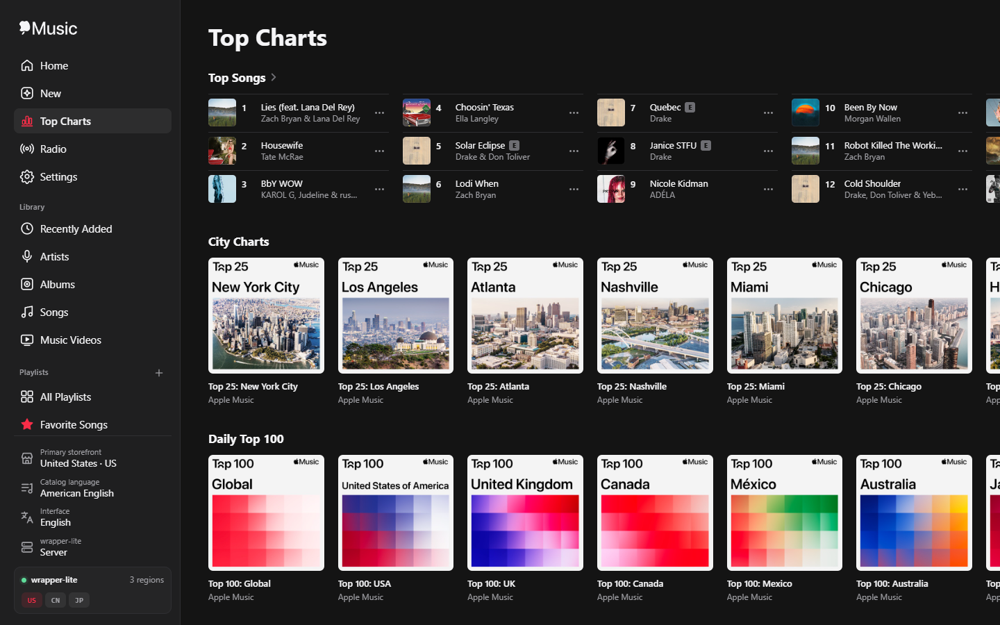
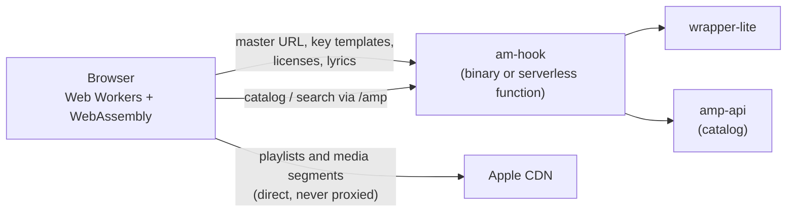

<div align="center">

# am-hook

**Apple Music in your browser: lossless, Dolby Atmos and music videos, decrypted with WebAssembly.**

[](https://github.com/itouakirai/am-hook/releases/latest)
[](https://github.com/itouakirai/am-hook/actions/workflows/build-test.yml)
[](LICENSE)
[](https://t.me/apple_music_alac)

[中文](README.zh-CN.md) | English



</div>

An Apple Music decryption tool written in Rust, covering songs (FairPlay HLS) and music videos (PlayReady HLS).

By default **decryption happens entirely in the browser**. The server only talks to wrapper-lite (master playlists, decryption templates, licenses). The browser fetches media straight from Apple's CDN and decrypts it with WebAssembly in Web Workers, so no media traffic goes through the server.

## Contents

- [Highlights](#highlights)
- [Screenshots](#screenshots)
- [Quick Start](#quick-start)
  - [Requirements](#requirements)
  - [Opening Apple Music links](#opening-apple-music-links)
- [Deployment](#deployment)
  - [Serverless Deployment (Vercel / Cloudflare)](#serverless-deployment-vercel--cloudflare)
  - [Using a local wrapper-lite](#using-a-local-wrapper-lite)
- [User Guide](#user-guide)
  - [Interface and Navigation](#interface-and-navigation)
  - [Player](#player)
  - [Pages](#pages)
  - [Songs](#songs)
  - [Lyrics and the Full-Screen Player](#lyrics-and-the-full-screen-player)
  - [Music Videos](#music-videos)
  - [Radio and Stations](#radio-and-stations)
  - [Library and Playlists](#library-and-playlists)
  - [Batch Downloads and Settings](#batch-downloads-and-settings)
- [How It Works](#how-it-works)
- [Reference](#reference)
  - [Command-Line Options](#command-line-options)
  - [Server Endpoints](#server-endpoints)
- [Development](#development)
  - [Building](#building)
  - [Testing](#testing)
  - [Project Layout](#project-layout)
- [Community](#community)
- [License](#license)

## Highlights

- **Every quality**: lossless ALAC (up to 24-bit / 192 kHz), Dolby Atmos, AAC, HE-AAC, binaural and downmix, plus music videos up to 4K Dolby Vision with Atmos audio.
- **Decrypted in the browser**: WebAssembly in Web Workers; media never passes through the server.
- **Plays anywhere**: built-in gapless player with a shared queue, ALAC-to-FLAC and EC-3-to-PCM fallbacks, system media controls.
- **Feels like music.apple.com**: search, New, Top Charts, Radio, album / playlist / artist / editorial pages, and synced lyrics rendered by [AMLL](https://github.com/amll-dev/applemusic-like-lyrics).
- **Downloads done properly**: per-track or whole albums / playlists, iTunes tags, cover art and lyrics, ZIP / folder / file output with name templates.
- **ALAC check**: without requesting `/key`, finds the ALAC escape frames whose end was overwritten across a whole album, with the packaging date and the real bit depth and bandwidth of the first 15 seconds.
- **Your library, locally**: library, playlists, favorites and folders kept in the browser's IndexedDB, with import / export.
- **Deploy your way**: a single binary, or Vercel / Cloudflare Workers with one click.

## Screenshots

<table>
  <tr>
    <td width="33%"></td>
    <td width="33%"></td>
    <td width="33%"></td>
  </tr>
  <tr>
    <td align="center">Album</td>
    <td align="center">Artist</td>
    <td align="center">Top Charts</td>
  </tr>
</table>

## Quick Start

Download a prebuilt binary for Windows, Linux or macOS from [Releases](https://github.com/itouakirai/am-hook/releases/latest), or build it yourself:

```sh
cargo build --release

# The browser decrypts; the server only serves playlists, templates and licenses
am-hook --listen 0.0.0.0:8888 --wrapper-url http://127.0.0.1:12340
```

Then open `http://127.0.0.1:8888/` and paste a link or search.

### Requirements

- A running [wrapper-lite](https://github.com/WorldObservationLog/wrapper) key server (default `http://127.0.0.1:12340`)
- A modern browser with Web Workers and WebAssembly. Playback uses MediaSource (EC-3 PCM fallback uses Web Audio); MV downloads need OPFS.
- Rust 2021 edition toolchain, only when building from source

> [!NOTE]
> OPFS is only available in a secure context: HTTPS, or `localhost` / `127.0.0.1`. Over `http://<LAN IP>`, song downloads fall back to in-memory Blobs (large files use more RAM) and MV downloads are unavailable. Playback is unaffected.

### Opening Apple Music links

Pages can also be opened directly by putting an Apple Music link after the server address:

| Input on the home page | Page opened |
|---|---|
| `https://music.apple.com/cn/song/<slug>/<id>` | `/https://music.apple.com/cn/song/<slug>/<id>` |
| `https://music.apple.com/cn/album/<slug>/<albumId>?i=<id>` | `/https://music.apple.com/cn/album/<slug>/<albumId>?i=<id>` |
| `https://music.apple.com/cn/music-video/<slug>/<id>` | `/https://music.apple.com/cn/music-video/<slug>/<id>` |
| `https://music.apple.com/cn/post/<id>` | `/https://music.apple.com/cn/post/<id>` |
| `https://music.apple.com/cn/playlist/<slug>/<pl.id>` | `/https://music.apple.com/cn/playlist/<slug>/<pl.id>` |
| `https://music.apple.com/cn/artist/<slug>/<id>` | `/https://music.apple.com/cn/artist/<slug>/<id>` |

For example: `http://127.0.0.1:8888/https://music.apple.com/cn/music-video/super-bowl-lix-halftime-show-live/1836358807`. The country code in the link selects the storefront used for metadata. Station, editorial and chart links open too; see [Pages](#pages).

## Deployment

The binary from [Quick Start](#quick-start) is the full-featured option: it relays wrapper-lite with rate limits (see [Command-Line Options](#command-line-options)) and works over plain `http://<LAN IP>`. The alternatives below need no binary.

### Serverless Deployment (Vercel / Cloudflare)

If you would rather not run the binary, the same pages can be deployed to a serverless platform: the platform hosts the static assets and the backend shrinks to a single function (the amp-api catalog proxy, the MV master fetch and the station endpoints). Pick either platform:

| Platform | One click | CLI |
|---|---|---|
| Vercel | [](https://vercel.com/new/clone?repository-url=https%3A%2F%2Fgithub.com%2Fitouakirai%2Fam-hook) | `npx vercel --prod` |
| Cloudflare Workers | [](https://deploy.workers.cloudflare.com/?url=https://github.com/itouakirai/am-hook) | `npx wrangler deploy` |

When deploying a fork, replace the repository URL in the button links with your own. The build needs only Node (`node scripts/build-static.mjs` builds `dist/` from `src/ui/`), not Rust; see [vercel.json](vercel.json) and [wrangler.toml](wrangler.toml) for the configuration.

**wrapper-lite**: a function on the platform cannot reach a wrapper-lite on your machine, so by default only the [local mode](#using-a-local-wrapper-lite) is offered. Enter your own wrapper-lite URL in the "wrapper-lite" setting at the bottom of the navigation and the browser sends the requests itself:

- The page is served over HTTPS, so the browser only lets it request `http://127.0.0.1` / `http://localhost` or HTTPS URLs; `http://<LAN IP>` is blocked as mixed content (if wrapper-lite runs on another machine, put it behind HTTPS or use the binary). Some browsers restrict loopback addresses too, and Chrome may first ask for permission to access the local network.
- wrapper-lite must allow cross-origin requests (see [Using a local wrapper-lite](#using-a-local-wrapper-lite)).

Alternatively the function can relay to a publicly reachable wrapper-lite, set through the platform's environment variables (on Cloudflare use `npx wrangler secret put <NAME>`; on Vercel redeploy after changing them):

| Variable | Description |
|---|---|
| `AM_HOOK_WRAPPER_URL` | wrapper-lite URL. When set, pages default to the "Server" mode, like the binary; it may carry credentials (`https://<token>@host`) |
| `AM_HOOK_WRAPPER_AUTH` | Optional `Authorization` for wrapper-lite requests, same rules as `--wrapper-auth` |
| `AM_HOOK_WRAPPER_HINT` | Optional note above the local wrapper-lite settings, same as `--wrapper-hint` |

> [!WARNING]
> With `AM_HOOK_WRAPPER_URL` set, anyone who can open the site can use your wrapper-lite, that is, your Apple account. Restrict access with the platform's access control (Vercel Deployment Protection, Cloudflare Access). Function instances share no state, so there is no equivalent of `--wrapper-rate` / `--wrapper-concurrency` here.

Other differences from the binary:

- amp-api responses are cached by the platform (Vercel CDN, Cloudflare Cache API; 5 minutes for the catalog, 24 hours for storefronts); there is no connection keep-alive or background warm-up, and the first catalog request of a new instance scrapes the developer token first, which takes a few seconds.
- No command-line options, request log or auto-update.
- On Vercel, page paths are matched by the rewrite rules in `vercel.json`, which are looser than the binary: invalid paths under `/library/…`, `/new/…` and `/https://music.apple.com/<cc>/…` get the app shell instead of a 404.

### Using a local wrapper-lite

The "wrapper-lite" setting at the bottom of the navigation switches between two modes (saved in the browser):

- **Server** (default): wrapper-lite requests are relayed by am-hook; rate, concurrency and `Authorization` come from the `--wrapper-*` options. Not offered on a [serverless deployment](#serverless-deployment-vercel--cloudflare) without `AM_HOOK_WRAPPER_URL`, or by a binary started with `--local-wrapper-only`.
- **Local**: the browser requests your own wrapper-lite directly (`/status`, `/m3u8`, `/key`, `/lyrics`, `/webplayback`, `/license`). The panel sets its URL, max requests per second, max concurrent requests and `Authorization` (same rules as `--wrapper-auth`). The limits apply to the current page only. The URL may carry credentials (such as `https://<token>@host`); as with `--wrapper-url`, they are sent as `Authorization: Basic …`, and a separately set `Authorization` takes precedence.
  - The requests are cross-origin: the wrapper-lite must allow CORS (send `Access-Control-Allow-Origin`, and allow the `Authorization` header in preflights if one is set), or install a browser extension that lifts CORS restrictions.
  - MV master playlists are still fetched by am-hook with `User-Agent: AM`; the other MV requests (`/webplayback`, `/license`) go to the local wrapper-lite.

## User Guide

### Interface and Navigation

- Chinese and English UI; the Interface button at the bottom of the navigation switches instantly (remembered; the first visit follows the browser language). Playback and downloads in progress are not interrupted.
- Settings at the bottom of the navigation, saved in localStorage with no expiry:
  - Primary storefront: used for search (and future features). The wrapper-lite account's storefronts are listed first as the best experience, then favorite storefronts (US / CN / JP by default); every other storefront sits under "More storefronts" with a filter, and the star next to each one adds or removes it from favorites. Defaults to the first wrapper-lite storefront.
  - Catalog language (amp-api `l`, independent of the UI language): defaults to each storefront's default language; the choices are only that storefront's `supportedLanguageTags` from `/amp/v1/storefronts`. Chosen per storefront, and also used for lyrics.
- The home page shows wrapper-lite status and your recent searches (click to search again, or remove them one by one); its footer links to this GitHub repository and credits the projects am-hook builds on.
- Search: the home input takes either a link or keywords (the same amp-api requests as music.apple.com). Typing shows suggested terms and direct results; results are grouped into top results, artists, albums, songs, playlists and music videos, with "Load more". Search uses the primary storefront, which can also be changed from the button next to the results. `/` focuses the input; the term is kept in the address bar as `?q=`, so Back / Forward and sharing work. Search lives only on the home page; other pages have a Back button at the top instead, which returns to the previous page (or to the home page when the page was opened directly from a link).
- The address bar, page title and browser Back / Forward follow the current page, so links can be shared and a reload stays on the same page.
- How it works: like music.apple.com, the site is a single-page app. Every page URL gets `app.html`, which owns the player bar, audio, decryption workers and lyrics view; a client-side router (`app.mjs`) takes over in-site links, changes the address with `history.pushState` and swaps page views (`src/ui/views/`) without reloading the document. It relies on no request headers, so it works the same over `http://<LAN IP>`.

### Player

Like music.apple.com, the player bar stays at the bottom and playback continues while you move between pages.

- A queue started on an album, playlist or artist page keeps playing in order after you leave the page, including previous / next from system media controls. Playing a different song on its song page ends the queue; switching quality of the same song keeps it.
- Like music.apple.com, the whole queue shares one MediaSource: the next song is fetched ahead and appended right after the current one, so the `<audio>` element never stops between songs. Playback continues gaplessly in the background (another app in front, including fullscreen apps) and the Android media notification stays. Songs played with EC-3 PCM still switch when the previous one ends.
- Transport controls match music.apple.com: shuffle, previous (restarts the song after 3 seconds), play / pause, next, and repeat (off → all → one). Shuffle and repeat are remembered; Shuffle on album, playlist and artist pages turns shuffle on and Play plays in order. Seek back / forward with ← / → or system media controls.
- Playing Next: the list button on the right of the bar opens the upcoming songs. Click to select, double-click to play, drag a row to reorder; the − on the artwork (on hover) removes a song and Clear empties the rest of the queue. From the keyboard: ↑/↓ select, Enter plays, Delete removes, Alt+↑/↓ moves. On touch screens a tap plays, the handle on the right reorders, and shuffle / repeat sit next to the title.
- Space and arrow keys control playback on every page. Playing a music video pauses the music and vice versa.

### Pages

Every page below is a route of the single-page app; the server returns `app.html` and the page loads its data from amp-api through `/amp`.

| Page | Description |
|---|---|
| `/` | Home: search, wrapper-lite status and recent searches |
| `/https://music.apple.com/<cc>/song/<slug>/<id>` | Song page (see [Songs](#songs)) |
| `/https://music.apple.com/<cc>/music-video/<slug>/<id>` | MV page (see [Music Videos](#music-videos)) |
| `/https://music.apple.com/<cc>/post/<id>` | Artist-uploaded video (MV page) |
| `/https://music.apple.com/<cc>/album/<slug>/<id>` | Album page (motion artwork from `editorialVideo` like music.apple.com — square on wide screens, full-width 3:4 on phones — tracks, playback queue, related shelves; data from the same amp-api `albums` request as music.apple.com). Album links with `?i=` open the album page with that track selected and scrolled into view, like music.apple.com |
| `/https://music.apple.com/<cc>/playlist/<slug>/<pl.id>` | Playlist page (editorial and public user playlists: motion artwork like the album page, tracks with artwork / artist / album columns, playback queue, featured-artists and more-by-curator shelves; data from the same amp-api `playlists` request as music.apple.com, fetched through `/amp`) |
| `/https://music.apple.com/<cc>/artist/<slug>/<id>` | Artist page (header like music.apple.com: motion video, wide image or circular portrait from the catalog data; latest release, top songs with a playback queue, album / music-video / playlist / similar-artist shelves with See All, bio; data from the same amp-api `artists` request as music.apple.com, fetched through `/amp`). Artist names on song, music-video and album pages (each artist of a multi-artist line separately) and artist shelves link here |
| `/new` | New (the sidebar's New entry): the same editorial sections as music.apple.com/{cc}/new (amp-api `editorial/{cc}/groupings?name=music`) for the primary storefront, reloaded when it changes — hero cards, four-row song shelves, album / playlist / radio / video shelves with the music.apple.com shelf-grid column counts, and the Explore More links; `/https://music.apple.com/<cc>/new` shows a fixed storefront |
| `/new/top-charts[/<kind>]` | Top Charts, linked from New's Explore More like music.apple.com/{cc}/new/top-charts (amp-api `catalog/{cc}/charts`, primary storefront): ranked top songs (three rows), city charts, Daily Top 100, and ranked top playlists / albums / music videos. Each ranked chart's See All (`songs`, `playlists`, `albums`, `music-videos`, also `city-charts`, `daily-global-top-charts`) lists the whole chart, paged on scroll — songs as chart rows like the playlist page — and songs / albums / music videos can be filtered by genre (`?genreId=`, genres from `catalog/{cc}/genres`); `/https://music.apple.com/<cc>/new/top-charts[/<kind>]` shows a fixed storefront |
| `/https://music.apple.com/<cc>/room/<id>`, `.../multi-room/<id>`, `.../grouping/<id>`, `.../curator/<slug>/<id>` | Editorial pages, routed like music.apple.com: a room is a section's See All (all contents in a grid, paged on scroll); multi-room (`editorial/{cc}/multirooms`, header art + sections), grouping (`editorial/{cc}/groupings/{id}`, e.g. Music Videos and genre pages) and curator (`catalog/{cc}?ids[apple-curators]=`: its grouping's sections, or its playlists) reuse the New layout. Legacy links in editorial data (`collection/...?fcId=`, `viewGrouping?id=`, `viewFeature?id=`) open these pages in app; stations open the station page here, and other content the site cannot open links to Apple Music. Pasting these links on the home page opens them too |
| `/radio` | Radio (Radio in the sidebar): the same editorial sections as music.apple.com/{cc}/radio for the primary storefront, plus Your Stations with a media-user-token; `/https://music.apple.com/<cc>/radio` is for a fixed storefront |
| `/https://music.apple.com/<cc>/station/<slug>/ra.<id>` | Station page: the next songs of personal and editorial stations, or the music video layout with playback and downloads for live radio and episodes (see [Radio and Stations](#radio-and-stations)) |
| `/library[/<section>]`, `/library/artists/<name>`, `/library/playlist/p.<id>`, `/library/favorite-songs`, `/library/playlist-folder/f.<id>` | Library pages (sections `recently-added`, `artists`, `albums`, `songs`, `music-videos`, `all-playlists`), local playlists, Favorite Songs and playlist folders. Library data lives in the browser's IndexedDB (`src/ui/library.mjs`); see [Library and Playlists](#library-and-playlists) |
| `/settings` | Settings (download settings and more). Settings live in the browser (`src/ui/prefs.mjs`); see [Batch Downloads and Settings](#batch-downloads-and-settings) |

### Songs

- Every variant is parsed automatically (lossless ALAC, Dolby Atmos, AAC, HE-AAC, including binaural and downmix versions), with artwork and track info fetched from the Apple Music catalog API (amp-api) via the server's `/amp` proxy.
- Each variant's "more" menu has **Download decrypted file**: decrypted in the browser and tagged with metadata, cover art and lyrics (per the download settings in Settings), with progress and a cancel button. Downloads keep running after you leave the song page (also shown in the download center) and are saved when done; returning to the song page shows their progress again (closing or reloading the tab stops them).
- Built-in player: MSE with browser-side decryption. ALAC plays losslessly via FLAC-in-MP4 when the browser lacks ALAC support. EC-3 falls back to multichannel PCM when MSE is unavailable, with a notice about the spatial-audio limitation. Downloads keep the original codec. Space, arrow keys and system media controls are supported.

### Lyrics and the Full-Screen Player

- When the playing song has lyrics, a Lyrics button appears on the player bar (available on every page; it switches to the new song's lyrics when the track changes).
- The view is rendered by [AMLL (Apple Music-like Lyrics)](https://github.com/amll-dev/applemusic-like-lyrics): word- and line-synced highlighting with spring scrolling, background vocals, duets, translation and pronunciation, interlude dots, and click-to-seek. Esc closes it.
- Its flowing background is AMLL's mesh gradient generated from the artwork, or the classic background used before AMLL (rotating, twisted and blurred copies of the artwork, modeled on Apple Music Web; also the fallback without WebGL).
- Clicking the artwork, title or empty space on the player bar opens the full-screen player (also for songs without lyrics, which show only the artwork and controls).
  - As on music.apple.com, the title has Favorite (☆) and More buttons (add to library, add to playlist, go to album, copy links), and the Lyrics button in the bottom-right corner (below the controls on phones) shows or hides the lyrics.
  - The buttons are laid out as on music.apple.com — Close at the top left, lyrics translation at the top right, and borderless playback buttons centered in one row, with title and artist on one line each, scrolling when too long.
  - Phones follow the site's mobile player: a pull-down handle at the top closes the view, the title row shrinks to a small artwork while lyrics are shown, and only Previous / Play / Next remain at the bottom, above the Lyrics and Playing Next toggles — the queue takes the place of the lyrics, with Shuffle / Repeat next to its title; with lyrics hidden the artwork and controls are centered, and the choice is saved in the browser.
- The lyrics options button (top right; it used to be only the translation menu):
  - toggles translation and pronunciation, and adjusts text size (70%–150%) and font weight (Light to Heavy);
  - switches the lyrics source between Apple Music and the [AMLL TTML DB](https://amll.dev/reference/http-api/overview) (looked up by the Apple Music song ID straight from the browser; songs it doesn't have fall back to Apple Music, and nothing is sent to it unless chosen);
  - switches the background between AMLL's and the classic one, and downloads the TTML being shown.
  - Everything except translation and pronunciation is saved in the browser.

### Music Videos

- Video and audio tracks appear in separate columns. The highest bitrate video and its group's default audio are selected; changing the video updates the recommended audio, and audio can also be chosen manually.
- Playback uses MediaSource with seeking and bounded buffering. Unsupported codecs remain downloadable; pick AVC/AAC for broader playback compatibility.
- Independent CEA-608 caption tracks are decoded into native browser text tracks. The first one is shown by default; use the video's subtitle menu to switch or disable captions.
- Downloads fetch a few segments ahead, decrypt them in order and write the fragments of the video track, then those of the audio track, to an OPFS temporary file, never holding the whole MV in memory. The Worker then rewrites that file as a standard (progressive) MP4 with `moov` before the media data, laid out like the reference `mv.Mux`: one chunk per source fragment run, tracks one after another (video with its captions, then audio). Tags and the thumbnail (per the tag settings in Settings) are written into `moov` at the same time; nothing is transcoded. Both files exist briefly during this step, so OPFS needs about twice the MV size.
- CEA-608 caption tracks are kept in the download. Apple starts them with a malformed empty sample that recent FFmpeg rejects (mpv-based players stop shortly after starting); it is rewritten as a valid empty caption sample of the same size.
- Completion triggers a save and exposes a "Save MP4" link. Cancellation and failure remove temporary files. Leaving the MV page stops playback, cancels a running download and attempts to remove the finished file. Files left by a closed or crashed tab are removed the next time an MV page is opened (without Web Locks, once they are 24 hours old).
- Artist-uploaded videos (music.apple.com `post` pages, amp-api `uploaded-videos`, linked from New and editorial pages) open in the same page. Like music.apple.com, they need neither wrapper-lite nor decryption: each entry of `assetTokens` is an unencrypted progressive MP4 (H.264 + AAC, `moov` first) that the `<video>` element plays directly. The page lists them by resolution with size and bitrate (from a `HEAD` request); there is no separate audio track. Downloads stream the file into OPFS unchanged (an in-memory Blob without OPFS).

### Radio and Stations

- **Radio** (`/radio`, between Top Charts and Settings in the sidebar and phone menu): the same editorial sections as music.apple.com/{cc}/radio (amp-api `editorial/{cc}/groupings?name=radio`) for the primary storefront; the live radio shelf shows each station's logo, a LIVE badge and the show on air. With a media-user-token, "Your Stations" comes first: the personal station (`stations?filter[identity]=personal`) and recently played stations (`me/recent/radio-stations`). Station links on New, editorial pages and Radio open the station page here.
- **media-user-token**: wrapper-lite has no station endpoints yet, so stations use the media-user-token of your Apple Music account to call Apple directly. The first time a station page opens you are asked for it (sign in at music.apple.com and copy `media-user-token` from the developer tools → Application → Cookies; a whole Cookie header also works); it is checked against `/v1/me/storefront` before it is saved. The token stays in this browser's localStorage and goes to the server in `X-Media-User-Token` with each request; the server relays it without storing, caching or logging it. When Apple rejects it you are asked again; Settings can change or clear it.
- **Station pages** (`/https://music.apple.com/<cc>/station/<slug>/ra.<id>`) come in three kinds, decided from `playParams` as MusicKit does:
  - Personal and editorial stations (`format: tracks`, such as genre stations and the personal station `ra.u-…`): the playlist page's header and track list, holding the station's next songs (`POST /v1/me/stations/next-tracks/<id>`, 10 at a time), with a new batch or more on demand; playback fetches the next batch before the queue runs out, so it keeps going like a station. Track More menus are the song ones (download included), and the header More menu downloads the listed songs.
  - Episodes (`format: stream`, `streamingRadioSubType: Episode`, audio or video): the music video page layout listing the HLS bitrates and tracks, with playback, seeking and downloads (`.m4a` for audio, `.mp4` for video, tagged with title, show, air date and artwork).
  - Live radio (`isLive`: Apple Music 1, broadcasters, and video shows that aired live): also the music video layout, starting near the live edge, with a LIVE badge, the song on air (ID3 in the segments' `emsg`, linked to its song page when it maps to one) and the schedule; no downloads.

### Library and Playlists

Like music.apple.com's Library and Playlists, but **stored only in your browser** (IndexedDB). The server keeps no library data and needs no account; nothing leaves the browser except the usual catalog requests.

- Sidebar: a Library group (Recently Added, Artists, Albums, Songs, Music Videos) and a Playlists group (All Playlists, then each playlist; + creates one). Pages live under `/library/...` and survive reloads and shared links (on the same browser).
- Adding: every More menu (search results, shelves, album / playlist / artist / chart rows) has **Add to Library** / **Delete from Library** and an **Add to Playlist** submenu (New Playlist…, then your playlists, most recently changed first). Album and playlist pages have a + button next to Play; song pages have Library and Add to Playlist buttons. As in Apple Music, adding an album adds all its songs and music videos, adding a single song makes its album and artist appear in the library, deleting an album deletes its songs, and adding an Apple Music playlist adds the playlist itself (it still opens the live catalog page). Tracks already in a playlist are skipped.
- Library pages: Songs (play / shuffle the filtered list, sort by title, artist, album, date added or duration; long lists render as you scroll), Albums and Music Videos grids, Artists (list beside the selected artist's albums and songs; on phones the list opens each artist), Recently Added, and All Playlists. Every page has a filter; the sort choice is remembered.
- Playlists (`/library/playlist/p.<id>`): a 2×2 mosaic of the first four album covers, name and description (Edit), play / shuffle, drag the handle to reorder (mouse or touch; ↑ / ↓ on the focused handle), Remove from Playlist, Duplicate, Export and Delete. Playlists keep a snapshot of each track (title, artists, album, artwork, duration), so they open instantly without catalog requests and also hold songs that are not in the library.
- Import / export (the ⋯ menu on library pages): **Export Library** saves `am-hook-library-<date>.json` with every library item and playlist; **Export Playlist** saves one playlist (`<name>.am-hook-playlist.json`) to share. **Import…** reads either file: a whole-library file can be merged (existing items stay, playlists with the same id keep the newer copy) or replace the library; a playlist file is added and opened. Every entry is validated: only `/https://music.apple.com/...` page links and https artwork are kept and invalid entries are skipped, so a shared file cannot inject links or scripts. **Clear Library…** deletes everything after a confirmation.
- Favorites: like Apple Music, songs, music videos, albums, playlists (Apple Music and your own) and artists can be favorited — **Favorite** / **Undo Favorite** in every More menu, and a ☆ next to the + on album and playlist pages, on song pages and in the artist page's action row. Favoriting also adds the item to the library (a favorited artist appears under Artists even without songs). Favorited tracks show a star; Songs, Albums, Artists, Music Videos and All Playlists have a **Favorites** filter. **Favorite Songs** (`/library/favorite-songs`, in the sidebar and first in All Playlists) is an automatic playlist of favorited songs, most recent first; Undo Favorite removes a song, and Save as Playlist copies it into a normal playlist.
- Playlist folders (`/library/playlist-folder/f.<id>`): create them from the + beside Playlists or the ⋯ menu, nest them, and put both your playlists and added Apple Music playlists inside, via **Move to Folder** (More menus and the playlist page) or by dragging a playlist or folder onto a folder in the sidebar (drop on the Playlists heading to move it to the top level). The sidebar lists folders first with expand / collapse (remembered; the folder of the open playlist expands automatically). A folder page shows its path, subfolders and playlists, with New Playlist, New Folder, Rename, Move, Export Folder and Delete Folder. As in Apple Music, deleting a folder deletes everything inside after a confirmation that shows the counts; a folder cannot move into itself or its subfolders.
- Storage notes: data is per browser and per site address (`http://127.0.0.1:8888` and `http://<LAN IP>:8888` are separate libraries); export to move it. Tabs of the same browser stay in sync. If the browser refuses IndexedDB (some private modes), the library works in memory for the session and the library pages say so.

<details>
<summary><b>Library file format (version 1)</b></summary>

```jsonc
{
  "format": "am-hook-library", "version": 1, "exportedAt": "2026-10-04T12:00:00.000Z",
  "items": [   // library: kind song / music-video / album / playlist (Apple Music), addedAt in ms
    { "kind": "song", "id": "1468058171", "country": "cn", "name": "…", "artist": "…", "artists": [{ "name": "…", "href": "/https://music.apple.com/cn/artist/…/159260351" }],
      "album": "…", "albumId": "1468058165", "albumHref": "/https://music.apple.com/cn/album/…/1468058165", "href": "/https://music.apple.com/cn/song/…/1468058171",
      "artwork": "https://…/{w}x{h}bb.jpg", "bgColor": "1d1d1f", "duration": 221000, "explicit": false, "addedAt": 1759579200000 }
  ],
  "playlists": [   // local playlists: tracks are the same snapshots plus uid / addedAt
    { "id": "p.Ab3dE…", "name": "…", "description": "…", "folderId": "f.Xy9…", "favorite": 0, "createdAt": 1759579200000, "updatedAt": 1759579300000, "tracks": [ { "uid": "…", "addedAt": 1759579200000, "kind": "song", "id": "…" } ] }
  ],
  "folders": [   // playlist folders; parentId is empty at the top level
    { "id": "f.Xy9…", "name": "…", "parentId": "", "createdAt": 1759579200000, "updatedAt": 1759579200000 }
  ]
}
```

`favorite` (ms, 0 = not favorited) on items and playlists, `folderId` on playlists and Apple Music playlist items, `folders`, and `artist` items (favorited artists) were added later as optional fields, so the version stays 1: older builds import new files and skip what they do not know. Export Folder writes the folder, its subfolders and their playlists. References to missing folders, and folder cycles, are moved to the top level on import. The browser database moved to version 2 (adds the `folders` store); existing libraries upgrade in place.

</details>

### Batch Downloads and Settings

- **Settings** (`/settings`, "Settings" below Top Charts in the sidebar and the phone menu): general settings (storefront, catalog language, UI language, wrapper-lite, same as at the bottom of the navigation) and download settings, stored in localStorage and applied immediately (running downloads keep the settings they started with); there is room for playback settings later. The download settings follow [apple-music-downloader](https://github.com/itouakirai/apple-music-downloader) and [amd.wol.moe](https://amd.wol.moe/):
  - Quality: preferred quality, grouped in the menu: Lossless ALAC / Dolby Atmos; AAC stereo 256 / 128 kbps and HE-AAC 64 kbps; AAC Binaural and AAC Downmix (from Atmos masters) at the same three bitrates. Also max ALAC sample rate, max Atmos (2768 / 2448), and whether to fall back when a track lacks it
  - Music videos: whether albums and playlists download their music videos too, max video resolution (the reference `mv-max`: the highest average bitrate at or below it) and audio (the reference `mv-audio-type`: Dolby Atmos → AC-3 → AAC, AC-3 → AAC, or AAC only)
  - Performance: tracks at once, retry attempts, OPFS staging
  - Save as: **ZIP** (one uncompressed file per album / playlist, ZIP64 above 4 GiB), **Folder** (written straight into a local folder through the File System Access API, with subfolders and optional skipping of existing files; desktop Chrome / Edge), or **Files**; playlists can include an `.m3u8`
  - File name templates for album / playlist folders (ZIP names), album tracks, playlist tracks and single songs; `/` makes subfolders, `{tracknum:02d}` pads, and the variables are `{title}` `{artist}` `{album}` `{album_artist}` `{composer}` `{genre}` `{tracknum}` `{tracktotal}` `{disk}` `{disktotal}` `{year}` `{release_date}` `{codec}` `{quality}` `{bit_depth}` `{sample_rate}` `{sample_rate_kHz}` `{explicit}` `{song_id}` `{album_id}` `{artist_id}` `{isrc}` `{upc}` `{record_label}` `{copyright}` `{playlist}` `{playlist_id}` `{curator}` `{index}`, with a live preview; `/` and other invalid characters in values become `_`
  - Tags: which fields to embed (title, artist, album, album artist, composer, genre, release date, track #, disc #, lyrics, cover, copyright, label, UPC, ISRC, rating, song / album / artist IDs), sort-order tags, original album info or playlist info for playlist tracks, metadata language
  - Cover art: JPEG / PNG / original, size, separate `cover.jpg`
  - Lyrics: separate `.lrc` / `.ttml`, word timing (enhanced LRC), translation / pronunciation lines, lyrics language
- **Downloading**: the download button on album and playlist pages (next to Play and Shuffle) opens a dialog to change the quality for this download and pick tracks (all songs by default, and the music videos unless that is turned off in Settings; unreleased tracks cannot be picked); songs, music videos, albums and playlists can also be downloaded from every More menu (track rows, search results, shelves…); "Download decrypted file" on the song page goes through the same download manager (`src/ui/downloads.mjs`) and is tagged too.
  - After each song is decrypted in the browser, `media.wasm` writes the iTunes tags (`moov.udta.meta.ilst`, the go-mp4tag fields) with cover art and lyrics into `moov` while converting to a progressive MP4, so the file is not rewritten a second time; cover art and lyrics are fetched alongside the audio and simply left out if unavailable
  - Metadata comes from amp-api `songs?ids=…&include=albums,artists` and `music-videos?ids=…` (one request per 100 tracks): composer, ISRC, track / disc numbers, and the album's UPC, copyright, label and track count
  - Music videos are downloaded like the reference `mvDownloader`: the MV master from wrapper-lite, the video and audio picked by the settings, then decrypted, muxed and defragmented by the MV engine into an `.mp4` named with the same templates (`{codec}` / `{quality}` describe the video and audio, e.g. `2160p HEVC Dolby Vision · Dolby Atmos`). Tags follow the reference `writeMVMP4Tags` (album info from the album or playlist, `PERFORMER`, `RELEASETIME`, the MV thumbnail as cover art) plus media type Music Video (`stik` 6). They need OPFS
  - ZIPs copy nothing: one Blob is assembled from the files in OPFS and the headers, with CRC-32 computed while defrag writes each file
- **Download center** (`src/ui/download-center.mjs`): stays at the bottom of the page like the player bar (above it) and keeps going across navigation; shows overall progress, speed and the current job, and expands into a list of albums / playlists / songs with each track's state, where you can cancel, retry (a job or a single track), save the finished part of a job with failures, save again or remove. Temporary files are deleted on removal or when the tab closes; closing the tab during a download asks for confirmation.
- **ALAC check**: the waveform button in the header of album, playlist and song pages, and "Check ALAC" in a song's More menu, check each track's best ALAC stream (`src/ui/alac-check.mjs`, dialog in `views/alac-check-dialog.mjs`) without requesting `/key`. Nothing starts until you press Start: select all, none or some of the tracks. The dialog shows the region, the album / playlist / song ID, each track's song ID and the check time, and the report can be copied as text.
  - **Web API and wrapper-lite masters**: by default only amp-api's `extendedAssetUrls.enhancedHls` is used, without wrapper-lite. The two can be packaged differently, and the wrapper-lite one sometimes has a better ALAC (song `1679278167`: 24-bit / 48 kHz on the web, also 24-bit / 96 kHz via wrapper-lite). With the option on, the wrapper-lite master is checked too; when both give the same best ALAC media m3u8 it is checked once, otherwise both are listed and the better one is marked. The song page's quality list (from wrapper-lite) is also compared with the web API's master, and qualities only wrapper-lite has are tagged "wrapper-lite only"
  - **Check while downloading** (Settings, off by default): ALAC downloads are checked as they download: the moofs and escape-frame ends are read from the raw segments before decryption and repair, with no extra requests. The result shows in the download center and goes into the custom tag `----:com.apple.iTunes:ALAC_CHECK` (name configurable), e.g. `result=damaged; noEnd=25; hidden=0; oversize=0; frames=2108; escapes=25; format=16/44100; bad=#124@11.517:noEnd,…; packaged=…; endTagRepair=on; checked=…`
  - **Damaged escape-frame ends** ([AppleMusicDecrypt#136](https://github.com/WorldObservationLog/AppleMusicDecrypt/issues/136)): Apple packages ALAC into an output buffer only as large as one frame of raw PCM, so the 4 extra bytes of an escape (uncompressed) frame are copied after the buffer is freed and hold heap metadata. The master m3u8 comes from amp-api's `extendedAssetUrls.enhancedHls`; only the moof at the start of each segment (a few KB) is downloaded, and for samples larger than one frame of PCM (16388 bytes in 16-bit stereo, 24580 in 24-bit) only the last 4 bytes, which cbcs leaves unencrypted because it encrypts whole 16-byte blocks only. If the PCM is not followed by the END tag `111` the frame is reported as "END tag missing" (FFmpeg and others drop it); with `111` but non-zero padding as "Hidden damage" (it decodes, but the last sample is wrong). Frame numbers, times and the last 4 bytes are listed
  - **Packaging**: the creation time in the init segment's `mvhd` (packaging date) and `udta/swre` (packager version)
  - **Real bit depth and bandwidth** (optional): the first segment (about 15 s) uses the fixed key, so it is decrypted in the browser and decoded by `flac.wasm` (`crates/am-flac-wasm/src/analysis.rs`): whether the low bits are always zero (16-bit audio in a 24-bit container), and the highest frequency of the average spectrum that is 20 dB above the container's quantization noise. Only a steep drop above it is reported as likely upsampled (for example 96 kHz with nothing above 22 kHz) or, at 44.1 / 48 kHz, as a likely lossy source; the spectrum is drawn

## How It Works



### Songs: browser-side decryption

In the browser (`src/ui/decrypt.js`):

1. With the master m3u8 URL from wrapper-lite, the browser fetches the master directly from the Apple CDN and parses its variants (`src/ui/wrapper.js`).
2. The media m3u8 is fetched directly from `aod.itunes.apple.com` (the CDN allows CORS and Range requests) and parsed into the init segment, fragment byte ranges and the key used by each fragment.
3. The first fragment uses the fixed template embedded in the wasm (`skd://itunes.apple.com/P000000000/s1/e1`); the rest use the track template from `/key`.
4. Fragments are fetched with Range requests and decrypted in place by a Worker pool (one `hook.wasm` instance per Worker). The decryption code lives in `crates/am-mp4`.
5. **Playback**: decrypted fragments feed MSE when the original codec is supported. If ALAC is unavailable but FLAC-in-MP4 is, the on-demand `flac.wasm` losslessly converts ALAC packets to FLAC frames and remuxes them into small fMP4 fragments. EC-3 uses MSE when supported, otherwise the on-demand `ec3.wasm` decoder plays 5.1/7.1 PCM through Web Audio (no Atmos object rendering). Seeking jumps to the matching source fragment.
6. **Download**: 4 lanes fetch and decrypt concurrently and write each result at its original offset into an OPFS temporary file, which is then converted to a progressive MP4 like the reference downloader's `DefragmentMP4` (`M4A ` ftyp, `moov` before the media data) and handed to the browser to save. Without OPFS it falls back to in-memory Blobs.

`hook.wasm` repairs identifiable ALAC end-tag damage after decryption (for example, song `1691044818`). The init segment's track and sample description identify complete uncompressed mono/stereo packets; a missing or damaged 3-bit `TYPE_END` is restored to `111` so decoders no longer drop the frame. The last 4 bytes of such packets were already overwritten when Apple packaged them ([AppleMusicDecrypt#136](https://github.com/WorldObservationLog/AppleMusicDecrypt/issues/136)): the original last sample is not in the file, and the repair cannot restore it. Sample lengths and Range offsets stay unchanged. Settings can turn the repair off: the overwritten samples are lost either way, and turning it off only keeps saved files byte-for-byte as Apple serves them (FFmpeg and others then drop the frames without an END tag). "Check ALAC" lists the affected frames. Compressed packets, truncated PCM and packets without room for the tag are left untouched; FLAC transcoding keeps its fallback that can append a missing tag byte.

Box handling: FairPlay metadata boxes (`sinf`, `senc`, `saiz`, `saio`, `pssh`, and `sgpd`/`sbgp` with grouping type `seig`/`seam`) are replaced with equal-length `free` boxes, so byte lengths and Range offsets stay exact. The `enca` box in the init segment is rewritten to the original codec (`ec-3`, `mp4a`, `alac`, etc.).

### Songs without a master m3u8 (AAC-LC only, Widevine)

Some songs (for example `1569279827`) have no master m3u8: wrapper-lite `/m3u8` returns a whole `.m4p` file. As in the reference downloader (`internal/widevine-rip`), they are played and downloaded from the 256 kbps AAC-LC stream used for web playback:

1. `songMaster` (`src/ui/wrapper.js`) sees that the URL is not an `.m3u8` (it is not fetched) and asks `/webplayback` (`/mv/webplayback/<adamId>` in server mode) for the media m3u8, offered as the only variant (`AAC · 256 kbps`, tagged "AAC-LC only"). A failed `/m3u8` request (HTTP 500, unreachable, …) is reported as an error and retried by batch downloads, never downgraded. Download settings are ignored for these songs, as in the reference; the file is marked as a fallback when another quality was preferred.
2. Its `EXT-X-KEY` is a `data:` URI with the key ID and the fragments are CENC (AES-CTR). The media Worker builds a Widevine license request (`crates/am-media/src/widevine.rs`, a port of the reference CDM with its built-in device; same `media_challenge` / `media_license` entry points as the MV PlayReady path) and sends it to wrapper-lite `/license` without `drm-type`. If Widevine fails, a PlayReady request for the same key ID is tried.
3. Fragments are decrypted with the content key in place by the same Worker pool (`hook_decrypt_cenc`, `cenc::decrypt_fragment_in_place`), keeping byte lengths, so playback, seeking and downloads work exactly as above.

### Music video decryption

- `/parse/mv/<adamId>` gets the master URL from wrapper-lite `/webplayback`, fetches it with `User-Agent: AM`, and returns the playlist text and final CDN URL. Browsers cannot change their User-Agent, and other User-Agents may get a master without 4K, so with a local wrapper-lite the master is still fetched by the server (`/parse/mv-master`).
- `/mv/webplayback/<adamId>` and `/mv/license` relay to wrapper-lite `/webplayback` and `/license` (MVs use PlayReady only; license errors are shown without falling back to another DRM). AAC-LC songs use the same two endpoints with Widevine requests (no `drm-type`).
- Track playlists and media segments are fetched by the browser directly from Apple.
- Challenge building, license parsing, CENC/CBCS decryption, caption repair, fragmented MP4 muxing and conversion to a progressive MP4 run in a Worker with `media.wasm` (Rust, see [crates/am-media](crates/am-media/README.md)).
- Live playlists, discontinuities and changing initialization segments are not supported.

### Station streams

- Station resources come through `/amp` as usual. Account requests go from the server to `amp-api.music.apple.com` (not edge, never cached) with the developer token and the media-user-token from the page: `/station/next-tracks/<id>`, `/station/assets` (`/v1/play/assets?<playParams>&keyFormat=web`, giving the HLS URL and license server), `/station/catalog/...`, `/station/recent` and `/station/storefront`.
- The browser fetches the HLS of live radio and episodes directly (`itsliveradio.apple.com` allows cross-origin requests); the fMP4 segments list FairPlay, PlayReady and Widevine `EXT-X-KEY`s. The media Worker shared with music videos and AAC-LC songs builds a Widevine license request (PlayReady if Widevine fails), shaped by the license server as MusicKit does (for example `{ adamId, challenge, uri, key-system, … }` for `linear.tv.apple.com/v1/radio/streaming-key-delivery`), and `/station/license` sends it to Apple with both tokens (plus `X-Apple-Renewal` for Widevine): wrapper-lite's `/license` does not support stations. With the content key the Worker decrypts the segments for MediaSource.
- Live playlists have no `#EXT-X-ENDLIST`: playback starts 3 segments before the end of the window, the playlist is refreshed every `TARGETDURATION` and segments are appended by sequence number, jumping to the newest ones after falling out of the window. Downloads are for episodes only and work like MV downloads: segments go to OPFS and are rewritten as a progressive MP4 (an audio-only stream keeps its own track).

## Reference

### Command-Line Options

| Flag | Default | Description |
|---|---|---|
| `-l, --listen <ADDR>` | `0.0.0.0:8888` | Listen address |
| `-p, --port <PORT>` | optional | Overrides the port in `--listen` when set |
| `-w, --wrapper-url <URL>` | `http://127.0.0.1:12340` | wrapper-lite key server base URL |
| `--wrapper-rate <N>` | `24` | Max requests per second to wrapper-lite (any 1-second window; extra requests wait in order). 0 = unlimited |
| `--wrapper-concurrency <N>` | `24` | Max concurrent requests to wrapper-lite. 0 = unlimited. Lower it (e.g. `8`) if wrapper-lite runs in QEMU and requests time out under load |
| `--wrapper-auth <VALUE>` | not sent | `Authorization` header for wrapper-lite requests. A bare token is sent as `Bearer <token>`; a value with a scheme (`Bearer …`, `Basic …`) is sent as is. Also read from `AM_HOOK_WRAPPER_AUTH` (keeps it out of the process list). These three apply to server relaying only; a page switched to a local wrapper-lite sets its own |
| `--client-rate <N>` | `0` | Max relayed wrapper-lite requests per client IP in any 60 seconds (`/status` not counted: it is shared by all clients and asks wrapper-lite at most once per 10 s), so one visitor cannot use up a shared wrapper-lite; further requests get HTTP 429 with `Retry-After`. A played song takes about 3 (master, key, lyrics). 0 = unlimited |
| `--client-concurrency <N>` | `0` | Max wrapper-lite requests relayed at once per client IP (`/status` not counted); further requests wait instead of failing, so one visitor's burst cannot hold every `--wrapper-concurrency` permit and stall everyone else. A played song needs 3 at once (master, key, lyrics). 0 = unlimited |
| `--client-ip-header <NAME>` | TCP peer | Header holding the client IP, set by the reverse proxy in front (e.g. `X-Real-IP`, `CF-Connecting-IP`; the first entry of a list is used). Needed behind a proxy, where every peer is the proxy. Only set it when all requests pass through that proxy, otherwise clients can spoof it |
| `--local-wrapper-only` | off | Never relay wrapper-lite requests: pages only offer the local mode, as on a serverless deployment without `AM_HOOK_WRAPPER_URL`, and the relaying endpoints return 501. `--wrapper-url`, `--wrapper-rate` and `--wrapper-concurrency` become the page defaults for visitors who have not saved their own; `--wrapper-auth` is not used and never sent to pages |
| `--wrapper-hint <TEXT>` | none | Note shown above the local wrapper-lite settings, e.g. where to get a token for a public wrapper-lite. URLs in it become links. Also read from `AM_HOOK_WRAPPER_HINT` |
| `--amp-keepalive <SECONDS>` | `30` | Keeps the amp-api connection warm: after this long idle, sends a tiny request (0 disables). The token is fetched and the connection opened at startup either way |
| `--amp-cache-mb <MB>` | `32` | amp-api response cache (catalog 5 min, storefronts 24 h; 0 disables). Identical concurrent requests always share one upstream request |
| `--check-update` | off | Checks GitHub Releases for a newer version at startup and logs it |
| `--auto-update` | off | Like `--check-update`, and also downloads the new binary for this platform and replaces the current one (the old one is kept as a backup); restart am-hook afterwards. On Windows the running exe cannot be replaced, so the log lists the manual steps |

### Server Endpoints

Page URLs (see [Pages](#pages)) all return the single-page app `app.html`. The API endpoints are:

| Endpoint | Description |
|---|---|
| `GET /status` | wrapper-lite status and available regions (one result shared by all clients for 10 s) |
| `GET /parse/song/<adamId>` | Song master m3u8 URL from wrapper-lite `/m3u8` (`{"code":0,"data":{"masterUrl":…}}`); the browser fetches and parses the master |
| `GET /key?adamId=<adamId>&uri=<skd-uri>` | Song track decryption template JSON from wrapper-lite `/key` |
| `GET /lyrics/<adamId>?language=<tag>` | TTML lyrics from wrapper-lite `/lyrics`, XML unchanged; 404 when the song has none. Optional `language` is the catalog language of the song's storefront (the chosen one, or the storefront default such as `zh-Hans-CN`) |
| `GET /parse/mv/<adamId>` | MV master playlist text and final CDN URL |
| `GET /parse/mv-master?url=<master URL>` | Same, for a master URL the page got from a local wrapper-lite; only `apple.com` HTTPS URLs are accepted |
| `GET /amp/v1/catalog/<path>?<query>` | Proxies Apple Music catalog API (`amp-api-edge.music.apple.com/v1/catalog/...`, used by home page search) with the music.apple.com web developer token; query passed through unchanged. Uses a dedicated HTTP/2 connection warmed at startup, caches successful responses, merges identical concurrent requests, and reports `Server-Timing` (`cache;desc=hit/miss/shared`, upstream time) |
| `GET /amp/v1/editorial/<path>?<query>` | Proxies the editorial API (`amp-api-edge.music.apple.com/v1/editorial/...`: groupings, rooms, multirooms; used by New and the editorial pages) like `/amp/v1/catalog`, sharing its connection and cache |
| `GET /amp/v1/storefronts` | All storefronts from amp-api (query passed through to follow `next` paging); pages fetch it once and keep it in localStorage (refreshed in the background after 30 days); it supplies the storefront picker and the catalog language choices (each storefront's `supportedLanguageTags`) (an unsupported `l` silently falls back to the storefront default, e.g. `cn` only supports `zh-Hans-CN` / `en-GB`) |
| `GET /mv/webplayback/<adamId>`, `POST /mv/license` | Relays to wrapper-lite `/webplayback` and `/license`: MVs (PlayReady, `drm-type: pr`) and songs without a master m3u8 (AAC-LC media m3u8, Widevine without `drm-type`) |
| `POST /station/next-tracks/ra.<id>`, `GET /station/assets?<playParams>`, `GET /station/catalog/<path>`, `GET /station/recent`, `GET /station/storefront` | Station endpoints: call `amp-api.music.apple.com` (`/v1/me/stations/next-tracks`, `/v1/play/assets`, `/v1/catalog`, `/v1/me/recent/radio-stations`, `/v1/me/storefront`) with the developer token and the media-user-token the page sends in `X-Media-User-Token`; responses are relayed as is and never cached; 401 without a token |
| `POST /station/license` | `{ url, body, renewal }`: POSTs `body` with both tokens to the station's license server (`url` must be an Apple HTTPS URL on a license path MusicKit knows) and relays the response |
| `/assets/...` | Client-side router, page views (`/assets/views/`), scripts, styles and on-demand WASM modules embedded in the binary. Pages load them by content-hashed URLs under `/assets/h/` (cached as `immutable`); the original URLs are served with `no-cache` + ETag. `/assets/host.js` tells the page whether the server can relay wrapper-lite (generated by the function on serverless deployments) |

## Development

### Building

```sh
cargo build --release
```

The binary is written to `target/release/am-hook` (`am-hook.exe` on Windows). All browser assets, including the prebuilt WASM modules, are committed under `src/ui/` and embedded into the binary, so a normal build needs only Rust. Rebuild the assets only after changing their sources:

| Asset | Source | Rebuild |
|---|---|---|
| `hook.wasm`, `flac.wasm`, `media.wasm` | `crates/am-wasm`, `crates/am-flac-wasm`, `crates/am-media-wasm` (and `am-mp4`, `am-alac`, `temari`, `am-media`) | `rustup target add wasm32-unknown-unknown` and [binaryen](https://github.com/WebAssembly/binaryen)'s `wasm-opt` (or `WASM_OPT="npx -y -p binaryen@123.0.0 wasm-opt"`), then `scripts/build-wasm.sh`. `hook.wasm` and `media.wasm` use the `wasm` profile in `Cargo.toml` (size-optimized, with the decryption hot spots temari and AES kept at `opt-level` 3) |
| `mv-cea608.mjs` | `browser/cea608` | `node scripts/build-cea608.cjs <path-to-typescript-package>` |
| `lyrics/amll-core.mjs`, `lyrics/amll.css` | `@applemusic-like-lyrics/core`, see [browser/amll](browser/amll/README.md) | `node scripts/build-amll.cjs <node_modules>` |
| `ec3.wasm`, `ec3-runtime.mjs` | `@mediabunny/ac3` 1.59.1 | `node scripts/extract-ec3.mjs`, see [EC3-SOURCE.md](src/ui/EC3-SOURCE.md) |

### Testing

```sh
cargo test --workspace
cargo clippy --workspace --all-targets -- -D warnings   # CI runs this too; the workspace is warning-free
```

Unit tests cover the browser media core (PlayReady and Widevine license decryption, CENC/CBCS including the length-preserving in-place path, caption repair, defragmentation), URL parsing, m3u8 parsing, MP4 box patching (including that the in-place wasm path matches the parallel path), cache deduplication and the MV endpoints. Offline integration tests also check that Apple CDN URLs are not proxied.

Tests that require the live Apple CDN or wrapper-lite are ignored by default and do not run in GitHub Actions. Run them locally with Apple CDN access and wrapper-lite available (default `http://127.0.0.1:12340`, override with `AM_HOOK_WRAPPER`):

```sh
cargo test --test e2e_test -- --ignored
```

These tests verify lyrics.

Browser-side tests are plain Node scripts. `<playwright>` is the path to a Playwright package; when `[base]` is omitted, the MV and radio live tests default to `http://127.0.0.1:18888` and the others to `AM_HOOK_URL` or `http://127.0.0.1:8888` (the ALAC tests only read `AM_HOOK_URL`).

<details>
<summary><b>Offline, Node only</b></summary>

| Command | Covers |
|---|---|
| `node --test tests/player_*.cjs` | Player |
| `node tests/mv_hls.cjs`, `node tests/mv_captions.cjs` | MV playlists and captions |
| `node --test tests/serverless.mjs` | The serverless backend and the `dist/` layout; also run in CI |
| `node --test tests/download_core.mjs` | ZIP / ZIP64, iTunes tags, file name templates |
| `node --test tests/alac_check.mjs` | ALAC check: escape-frame end verdicts (including the cases from issue #136), moof / init parsing, the fixed key in multi-DRM playlists, bandwidth verdicts; also run by CI |

</details>

<details>
<summary><b>Offline, Playwright + Chrome with local fixtures</b></summary>

| Command | Covers |
|---|---|
| `node tests/ui_layout.cjs <playwright>` | Page layout |
| `node tests/lyrics_ui.cjs <playwright>` | Lyrics view |
| `node tests/mv_ui.cjs <playwright>` | MV page |
| `node tests/library_ui.cjs <playwright>` | Library and playlists: add, playlists, reorder, persistence, export / import and file validation, favorites, folders and drag-and-drop, database upgrade |
| `node tests/station_ui.cjs <playwright>` | Radio and station pages: nav position, live shelf and Your Stations, the first media-user-token prompt, next songs and refills, episode and live layouts, Settings |

</details>

<details>
<summary><b>Live (running am-hook, wrapper-lite, Apple CDN access)</b></summary>

| Command | Covers |
|---|---|
| `node tests/mv_live.cjs <playwright> [base]`, `node tests/mv_captions_live.cjs <playwright> [base]` | MV playback and captions |
| `node tests/alac_recovery.cjs <playwright>`, `node tests/alac_source_recovery.cjs <playwright>` | ALAC end-tag repair |
| `node tests/alac_check_ui.cjs <playwright> [base]` | Album page ALAC check: the two damaged frames of Shadows In The Night from issue #136, packaging date, first-15-seconds analysis, copied report, no `/key` request (wrapper-lite not needed) |
| `node tests/aac_lc_live.cjs <playwright> [base]` | A song without a master: AAC-LC variant, Widevine license, playback and seeking in server and local modes, download to `target/` |
| `node tests/search_ui.cjs <playwright> [base]`, `node tests/album_ui.cjs <playwright> [base]`, `node tests/playlist_ui.cjs <playwright> [base]`, `node tests/artist_ui.cjs <playwright> [base]`, `node tests/browse_ui.cjs <playwright> [base]` | Search, album, playlist, artist and browse pages (need access to music.apple.com) |
| `node tests/app_ui.cjs <playwright> [base]` | Single-page app: playback across navigation, queue, Back / Forward, lyrics |
| `node tests/download_ui.cjs <playwright> [base]` | Batch downloads: settings, album ZIP tags / cover / lyrics, folder mode, playlists and .m3u8, music videos, cancel / retry; needs wrapper-lite with the cn region |
| `node tests/radio_live.cjs <playwright> [base] [token-file]` | Stations: needs a media-user-token from token-file, `AM_HOOK_MEDIA_USER_TOKEN` or `target/my-media-user-token.txt`; genre and personal stations, Widevine license / playback / seeking / M4A download of an episode from recently played radio, and live radio simulated over its segments |

</details>

### Project Layout

<details>
<summary><b>Source tree</b></summary>

```
src/
  cli.rs               CLI argument parsing
  main.rs              Server startup
  lib.rs               Router construction
  assets.rs            Embedded front-end assets: one table (`ASSETS`) drives both the routes and the MIME types; add a browser file by adding one line
  amp.rs               amp-api catalog proxy (fetches and refreshes the music.apple.com web developer token) and station endpoints (media-user-token and license relays)
  limit.rs             Per-client-IP rate and concurrency limits for relayed wrapper-lite requests
  log.rs               Request log
  links.rs             Apple Music link parsing and page-path matching (shared regex fragments; log.rs reuses them to classify requests)
  state.rs             Configuration and shared clients
  updater.rs           --check-update / --auto-update (GitHub Releases)
  wrapper.rs           wrapper-lite client (master m3u8, decryption templates, lyrics)
  ui.rs                Web endpoints (status, parse, templates, lyrics, MV relays; fallback serves the single-page app for Apple Music page paths)
  ui/
    app.html / app.mjs Single-page app: persistent player bar and lyrics view; the client-side router takes over in-site links and swaps page views
    views/             Page views: <name>.html markup, <name>.mjs script (home / song / mv / album / playlist / artist / browse: New, Radio and editorial pages, styles in browse.css; station: station pages)
    app.css / mv.css   Styles
    i18n.js            Chinese / English strings; primary storefront and catalog language settings
    settings.mjs       Primary storefront / catalog language picker
    prefs.mjs          Settings store (download settings and more, localStorage); the page is views/settings.mjs
    downloads.mjs      Batch download manager (quality choice, metadata, cover art and lyrics, save modes); download-center.mjs is the persistent download center, views/download-dialog.mjs the album / playlist download dialog
    mp4-tags.mjs / zip.mjs / naming.mjs / lrc.mjs   iTunes tags (ilst), uncompressed ZIP (with ZIP64), file name templates, TTML to LRC
    library.mjs        Library and playlist store (IndexedDB, cross-tab sync, import / export format and validation); pages in views/library*.mjs, shared dialogs and menus in views/library-ui.mjs
    player.js          Song player (MSE) and playback queue; page views use the persistent player via scope()
    motion-art.mjs     Motion artwork on album, playlist and artist pages (editorialVideo HLS via MSE)
    decrypt.js         Song decryption: m3u8 parsing, Worker pool, templates, download and OPFS
    hook-worker.js     Worker: wasm decryption and OPFS writes
    hook.wasm          Build output of crates/am-wasm
    flac.wasm / flac-transcode-worker.js / flac-init.bin   ALAC-to-FLAC playback; decoding for the ALAC check
    alac-check.mjs     album page ALAC check (damaged escape-frame ends, packaging, real bit depth and bandwidth); dialog in views/alac-check-dialog.mjs
    ec3.wasm / ec3-runtime.mjs / ec3-decode-worker.js      EC-3 PCM fallback
    lyrics/            Lyrics view (bundled AMLL, see browser/amll; ttml.mjs parses TTML, panel.mjs wires it to the player, backdrop*.mjs draw the classic background)
    station.mjs        Station endpoints needing a media-user-token: storing and asking for the token, next tracks, play assets, license request formats
    mv-radio.mjs       Station HLS playback and downloads (live radio and episodes, sharing the media Worker with MVs)
    mv-hls.mjs / mv-engine.mjs                            MV playlist parsing and track selection, playback, download
    media-worker.js / media.wasm                          Worker for MVs and song defragmentation; build output of crates/am-media-wasm
    mv-captions.mjs / mv-cea608.mjs                       CEA-608 captions
crates/
  am-mp4/              ISOBMFF parsing, box patching, sample decryption (shared by server and wasm); embeds the fixed first-fragment template
  am-alac/             Conservative ALAC end-tag repair
  am-wasm/             Browser C ABI exports of am-mp4 (wasm32-unknown-unknown)
  am-flac-wasm/        ALAC packet decoder and FLAC frame writer for the browser; PCM analysis (real bit depth, bandwidth, analysis.rs)
  am-media/            Browser media core: PlayReady, Widevine, CENC/CBCS, caption repair, MP4 muxing and defragmentation
  am-media-wasm/       Browser C ABI exports of am-media
  temari/              Vendored Temari FairPlay decryption library
browser/
  cea608/              Vendored hls.js CEA-608 parser
  amll/                AMLL lyric player bundle entry and build notes
serverless/
  core.mjs             Serverless backend (amp-api proxy, MV master, station endpoints, optional wrapper-lite relay), the counterpart of amp.rs and ui.rs
  cloudflare.mjs       Cloudflare Worker entry (wrangler.toml)
api/handler.mjs        Vercel Edge Function entry (vercel.json)
scripts/               WASM / asset build scripts; build-static.mjs builds dist/ for serverless deployments from the asset table in assets.rs
tests/                 Rust integration tests and Node browser tests (app.cjs holds the shared page helpers)
docs/                  Release guide (RELEASE.md) and README screenshots
```

</details>

## Community

Questions, feedback and discussion: the Telegram group [@apple_music_alac](https://t.me/apple_music_alac). Bug reports and feature requests are still welcome in [Issues](https://github.com/itouakirai/am-hook/issues).

## License

am-hook is licensed under the [GNU Affero General Public License v3.0 only](LICENSE) (AGPL-3.0-only), because the web UI embeds the AGPL-licensed [AMLL](https://github.com/amll-dev/applemusic-like-lyrics) lyric player. If you run a modified version as a network service, you must offer its users the corresponding source.

Bundled third-party components keep their own licenses: `crates/temari` (MIT), the hls.js CEA-608 parser (Apache-2.0, `browser/cea608/LICENSE`), `@mediabunny/ac3` (MPL-2.0, `src/ui/EC3-LICENSE.txt`) and AMLL with its dependencies (AGPL-3.0-only, `browser/amll`).
