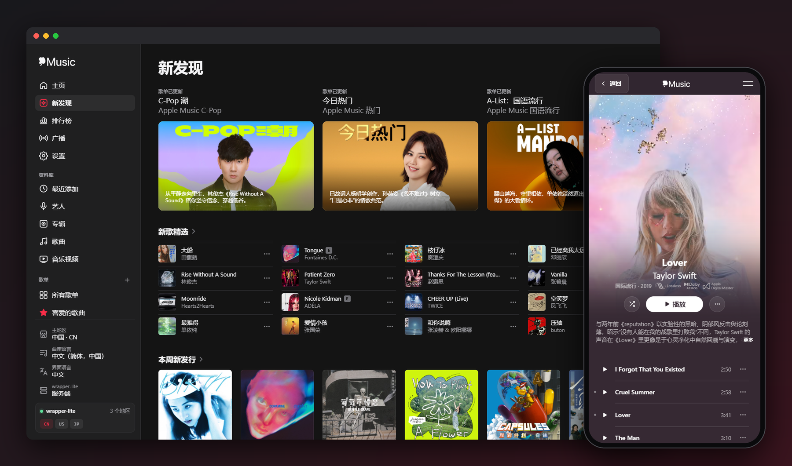
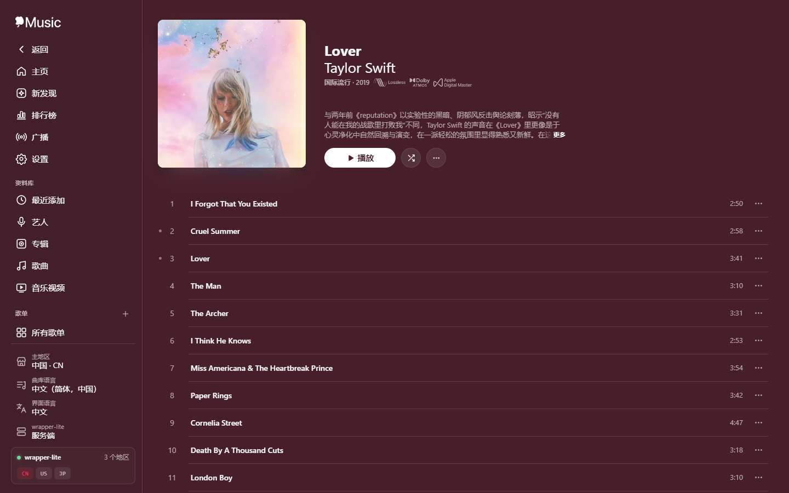
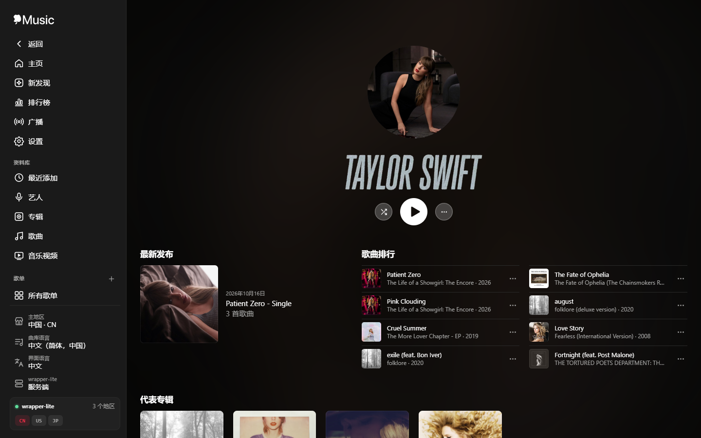
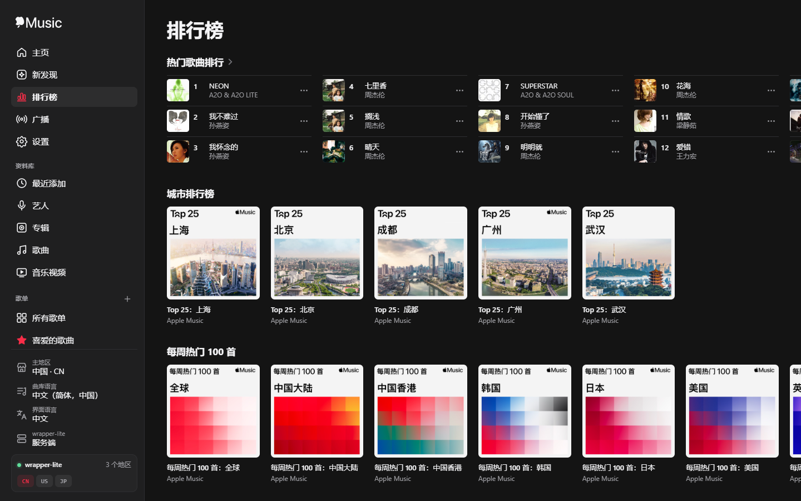
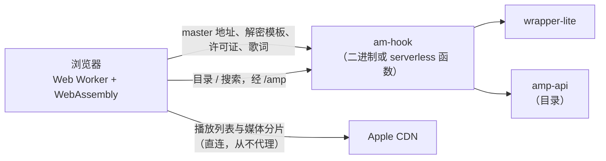

<div align="center">

# am-hook

**在浏览器里听 Apple Music：无损、杜比全景声与 MV，全部由 WebAssembly 在本地解密。**

[](https://github.com/itouakirai/am-hook/releases/latest)
[](https://github.com/itouakirai/am-hook/actions/workflows/build-test.yml)
[](LICENSE)
[](https://t.me/apple_music_alac)

中文 | [English](README.md)



</div>

一个用 Rust 编写的 Apple Music 解密工具，支持歌曲（FairPlay HLS）和 MV（PlayReady HLS）。

**解密完全在浏览器中完成**：服务端只与 wrapper-lite 通信（master 播放列表、解密模板、许可证），媒体数据由浏览器直接从 Apple CDN 获取，并在 Web Worker 中用 WebAssembly 解密，不消耗服务器流量。

## 目录

- [亮点](#亮点)
- [截图](#截图)
- [快速开始](#快速开始)
  - [环境要求](#环境要求)
  - [打开 Apple Music 链接](#打开-apple-music-链接)
- [部署](#部署)
  - [Serverless 部署（Vercel / Cloudflare）](#serverless-部署vercel--cloudflare)
  - [使用本地 wrapper-lite](#使用本地-wrapper-lite)
- [使用指南](#使用指南)
  - [界面与导航](#界面与导航)
  - [播放器](#播放器)
  - [页面一览](#页面一览)
  - [歌曲](#歌曲)
  - [歌词与全屏播放界面](#歌词与全屏播放界面)
  - [MV](#mv)
  - [广播与电台](#广播与电台)
  - [资料库与歌单](#资料库与歌单)
  - [批量下载与设置中心](#批量下载与设置中心)
- [工作原理](#工作原理)
- [参考](#参考)
  - [命令行参数](#命令行参数)
  - [服务端接口](#服务端接口)
- [开发](#开发)
  - [构建](#构建)
  - [测试](#测试)
  - [项目结构](#项目结构)
- [交流群](#交流群)
- [许可证](#许可证)

## 亮点

- **全部音质**：无损 ALAC（最高 24-bit / 192 kHz）、杜比全景声、AAC、HE-AAC、双耳与缩混版本，以及最高 4K 杜比视界、全景声音轨的 MV。
- **浏览器内解密**：Web Worker 中的 WebAssembly 完成解密，媒体数据不经过服务器。
- **到处都能播**：内置无缝衔接的播放器与播放队列，ALAC 转 FLAC、EC-3 转 PCM 兜底，支持系统媒体控制。
- **与 music.apple.com 一样的体验**：搜索、新发现、排行榜、广播，专辑 / 歌单 / 艺人 / 编辑页，以及由 [AMLL](https://github.com/amll-dev/applemusic-like-lyrics) 渲染的逐字歌词。
- **完整的下载**：单曲或整张专辑 / 歌单，写入 iTunes 标签、封面与歌词，可保存为 ZIP / 文件夹 / 逐个文件，支持文件名模板。
- **ALAC 检测**：不请求 `/key`，找出整张专辑中末尾被覆盖的 ALAC 原样帧，并给出打包日期与前 15 秒的实际位深、频宽。
- **本地资料库**：资料库、歌单、喜爱与文件夹保存在浏览器的 IndexedDB 中，可导入 / 导出。
- **部署方式随意**：单个二进制，或一键部署到 Vercel / Cloudflare Workers。

## 截图

<table>
  <tr>
    <td width="33%"></td>
    <td width="33%"></td>
    <td width="33%"></td>
  </tr>
  <tr>
    <td align="center">专辑</td>
    <td align="center">艺人</td>
    <td align="center">排行榜</td>
  </tr>
</table>

## 快速开始

从 [Releases](https://github.com/itouakirai/am-hook/releases/latest) 下载 Windows / Linux / macOS 的预编译二进制，或自行构建：

```sh
cargo build --release

# 浏览器端解密，服务端只提供播放列表、解密模板与许可证
am-hook --listen 0.0.0.0:8888 --wrapper-url http://127.0.0.1:12340
```

浏览器打开 `http://127.0.0.1:8888/`，粘贴链接或搜索即可。

### 环境要求

- 运行中的 [wrapper-lite](https://github.com/WorldObservationLog/wrapper) 密钥服务（默认 `http://127.0.0.1:12340`）
- 支持 Web Worker 和 WebAssembly 的现代浏览器。播放使用 MediaSource（EC-3 PCM 回退使用 Web Audio）；MV 下载需要 OPFS。
- Rust 2021 edition 工具链（仅从源码构建时需要）

> [!NOTE]
> OPFS 只在安全上下文中可用，也就是 HTTPS 或 `localhost` / `127.0.0.1`。通过 `http://<局域网 IP>` 访问时，歌曲下载退回内存 Blob（大文件占用较多内存），MV 无法下载；播放不受影响。

### 打开 Apple Music 链接

也可以把 Apple Music 链接直接拼在服务地址后面打开对应页面：

| 首页输入 | 打开的页面 |
|---|---|
| `https://music.apple.com/cn/song/<slug>/<id>` | `/https://music.apple.com/cn/song/<slug>/<id>` |
| `https://music.apple.com/cn/album/<slug>/<albumId>?i=<id>` | `/https://music.apple.com/cn/album/<slug>/<albumId>?i=<id>` |
| `https://music.apple.com/cn/music-video/<slug>/<id>` | `/https://music.apple.com/cn/music-video/<slug>/<id>` |
| `https://music.apple.com/cn/post/<id>` | `/https://music.apple.com/cn/post/<id>` |
| `https://music.apple.com/cn/playlist/<slug>/<pl.id>` | `/https://music.apple.com/cn/playlist/<slug>/<pl.id>` |
| `https://music.apple.com/cn/artist/<slug>/<id>` | `/https://music.apple.com/cn/artist/<slug>/<id>` |

例如：`http://127.0.0.1:8888/https://music.apple.com/cn/music-video/super-bowl-lix-halftime-show-live/1836358807`。链接中的国家代码决定获取展示信息时使用的地区。电台、编辑页与排行榜的链接同样可以打开，见[页面一览](#页面一览)。

## 部署

[快速开始](#快速开始)中的二进制功能最完整：转发 wrapper-lite 时可以限速限并发（见[命令行参数](#命令行参数)），通过普通的 `http://<局域网 IP>` 也能使用。下面的方式不需要二进制。

### Serverless 部署（Vercel / Cloudflare）

不想运行二进制的话，可以把同一套页面部署到 serverless 平台：静态资源由平台托管，后端只剩一个函数（amp-api 目录代理、MV master 获取与电台接口）。两个平台任选其一：

| 平台 | 一键部署 | 命令行 |
|---|---|---|
| Vercel | [](https://vercel.com/new/clone?repository-url=https%3A%2F%2Fgithub.com%2Fitouakirai%2Fam-hook) | `npx vercel --prod` |
| Cloudflare Workers | [](https://deploy.workers.cloudflare.com/?url=https://github.com/itouakirai/am-hook) | `npx wrangler deploy` |

部署 fork 时把按钮链接里的仓库地址换成自己的。构建只需要 Node（`node scripts/build-static.mjs` 由 `src/ui/` 生成 `dist/`），不需要 Rust；配置见 [vercel.json](vercel.json) 与 [wrangler.toml](wrangler.toml)。

**wrapper-lite**：平台上的函数访问不到你本机的 wrapper-lite，所以默认只有[本地模式](#使用本地-wrapper-lite)——在导航底部的「wrapper-lite」设置里填写自己的 wrapper-lite 地址，请求由浏览器直接发出：

- 页面是 HTTPS 的，浏览器只允许它请求 `http://127.0.0.1` / `http://localhost` 或 HTTPS 地址；`http://<局域网 IP>` 会被当作混合内容拦截（wrapper-lite 在另一台机器上时需要给它加 HTTPS，或改用二进制）。部分浏览器对回环地址也有限制，Chrome 可能会先询问是否允许访问本地网络。
- wrapper-lite 需允许跨源请求（见[使用本地 wrapper-lite](#使用本地-wrapper-lite)）。

也可以让函数转发到一个公网可达的 wrapper-lite，在平台的环境变量里设置（Cloudflare 用 `npx wrangler secret put <名称>`；Vercel 修改后需重新部署）：

| 环境变量 | 说明 |
|---|---|
| `AM_HOOK_WRAPPER_URL` | wrapper-lite 地址。设置后页面默认使用「服务端」模式，与二进制相同；可带用户信息（`https://<token>@host`） |
| `AM_HOOK_WRAPPER_AUTH` | 可选，wrapper-lite 请求的 `Authorization`，规则与 `--wrapper-auth` 相同 |
| `AM_HOOK_WRAPPER_HINT` | 可选，显示在本地 wrapper-lite 设置上方的提示，同 `--wrapper-hint` |

> [!WARNING]
> 设置 `AM_HOOK_WRAPPER_URL` 后，能打开站点的人都能使用你的 wrapper-lite（也就是你的 Apple 账号）。请用平台的访问控制（Vercel Deployment Protection、Cloudflare Access）限制访问。函数实例之间不共享状态，这里没有 `--wrapper-rate` / `--wrapper-concurrency` 那样的限速与限并发。

与二进制的其他区别：

- amp-api 的响应由平台缓存（Vercel CDN、Cloudflare Cache API；目录 5 分钟、地区表 24 小时），没有连接保活与后台预热；新实例的第一个目录请求要先抓取 developer token，会慢几秒。
- 没有命令行参数、请求日志与自动更新。
- Vercel 上页面地址由 `vercel.json` 的改写规则匹配，比二进制宽松：`/library/…`、`/new/…` 与 `/https://music.apple.com/<cc>/…` 下无效的地址也返回页面外壳而不是 404。

### 使用本地 wrapper-lite

导航底部的「wrapper-lite」设置可以在两种方式间切换（保存在浏览器中）：

- **服务端**（默认）：wrapper-lite 请求经 am-hook 转发，限速、限并发与 `Authorization` 由 `--wrapper-*` 参数决定。[Serverless 部署](#serverless-部署vercel--cloudflare)没有设置 `AM_HOOK_WRAPPER_URL`、或二进制以 `--local-wrapper-only` 启动时没有这一项。
- **本地**：浏览器直接请求你自己的 wrapper-lite（`/status`、`/m3u8`、`/key`、`/lyrics`、`/webplayback`、`/license`），在面板中填写地址、每秒请求数上限、同时请求数上限与 `Authorization`（规则与 `--wrapper-auth` 相同）。限制只作用于当前页面。地址可以带用户信息（如 `https://<token>@host`），与 `--wrapper-url` 相同，转为 `Authorization: Basic …` 发送；单独填写的 `Authorization` 优先。
  - 请求是跨源的：wrapper-lite 需允许跨源请求（返回 `Access-Control-Allow-Origin`，填了 `Authorization` 时还需在预检中允许该请求头），或在浏览器中安装解除跨域限制的插件。
  - MV 的 master 播放列表仍由 am-hook 以 `User-Agent: AM` 获取，其余 MV 请求（`/webplayback`、`/license`）直连本地 wrapper-lite。

## 使用指南

### 界面与导航

- 界面支持中文 / English，导航底部的「界面语言」一键切换（会记住选择；首次访问按浏览器语言决定）。切换时正在进行的播放和下载不受影响。
- 导航底部的设置，保存在 localStorage，不会过期：
  - 主地区：用于搜索（以及之后的功能）。wrapper-lite 账号所在地区排在最前（最佳体验），其次是收藏的地区（默认收藏 US / CN / JP）；其他地区收在「更多地区」里，展开后可筛选，每个地区右侧的星标可收藏 / 取消收藏。默认为 wrapper-lite 的第一个地区。
  - 曲库语言（amp-api 的 `l`，与界面语言相互独立）：默认为各地区的默认语言，可选项只有 `/amp/v1/storefronts` 中该地区的 `supportedLanguageTags`。按地区分别记住，歌词也使用它。
- 首页显示 wrapper-lite 状态，以及最近搜索的关键词（点击可再次搜索，也可逐条删除）；页面底部有本项目的 GitHub 链接和对所用开源项目的致谢。
- 搜索：首页输入框既能粘贴链接，也能按关键词搜索（与 music.apple.com 相同的 amp-api 请求）。输入时显示补全词与直达结果；结果按最佳结果、艺人、专辑、歌曲、歌单、MV 分组，可「加载更多」。搜索使用主地区，也可在结果旁的按钮里修改。按 `/` 聚焦输入框；搜索词记在地址栏 `?q=` 中，可前进 / 后退与分享。搜索只在首页；其他页面顶部是「返回」按钮，回到上一页（直接打开链接进入时回到首页）。
- 地址栏、页面标题和浏览器前进 / 后退跟随当前页面，链接可以直接分享，刷新后仍停留在当前页。
- 实现方式：与 music.apple.com 相同，整站是单页应用。服务端对所有页面地址都返回 `app.html`，播放条、音频、解密 Worker 和歌词界面常驻其中；站内链接由前端路由（`app.mjs`）接管，用 `history.pushState` 改地址并切换页面视图（`src/ui/views/`），文档不重新加载。不依赖任何请求头，通过 `http://<局域网 IP>` 访问时同样有效。

### 播放器

与 music.apple.com 相同，底部播放条常驻，在站内页面之间跳转时播放不中断。

- 专辑、歌单、艺人页开始的播放队列在离开页面后继续按顺序播放，系统媒体控制的上一首 / 下一首同样可用；在歌曲页单独播放另一首歌会结束队列，切换同一首歌的音质则保留。
- 与 music.apple.com 相同，整个队列共用一个 MediaSource：下一首提前获取并接在当前歌曲之后，歌曲之间 `<audio>` 不停止。切到其他应用（包括全屏应用）时后台也能无缝切歌，Android 通知栏的媒体卡片不会消失。EC-3 PCM 播放的歌曲仍在上一首结束后再切换。
- 播放控件与 music.apple.com 相同：随机播放、上一首（已播放超过 3 秒时回到开头）、播放 / 暂停、下一首、重复播放（关 → 全部 → 单曲）。随机与重复状态会记住；专辑、歌单、艺人页的「随机播放」开启随机，「播放」按顺序播放。快退 / 快进用 ← / → 键或系统媒体控制。
- 待播清单：点播放条右侧的列表按钮打开。单击选中、双击播放，拖动整行调整顺序；悬停时封面左上角的 − 移出清单，「清除」清空后续歌曲。键盘 ↑/↓ 选择、Enter 播放、Delete 移除、Alt+↑/↓ 移动。触屏上点按播放、拖动右侧把手排序，随机 / 重复按钮在清单标题旁。
- 空格 / 方向键在任何页面都能控制播放；播放 MV 时会暂停音乐，反之亦然。

### 页面一览

下面的页面都是单页应用的路由：服务端返回 `app.html`，页面经 `/amp` 从 amp-api 加载数据。

| 页面 | 说明 |
|---|---|
| `/` | 首页：搜索、wrapper-lite 状态与最近搜索 |
| `/https://music.apple.com/<cc>/song/<slug>/<id>` | 歌曲页（见[歌曲](#歌曲)） |
| `/https://music.apple.com/<cc>/music-video/<slug>/<id>` | MV 页（见 [MV](#mv)） |
| `/https://music.apple.com/<cc>/post/<id>` | 艺人上传的视频（MV 页） |
| `/https://music.apple.com/<cc>/album/<slug>/<id>` | 专辑页（与 music.apple.com 相同的 `editorialVideo` 动态封面：宽屏方形、手机全宽 3:4；曲目列表、连续播放、相关推荐货架；数据来自与 music.apple.com 相同的 amp-api `albums` 请求）。带 `?i=` 的专辑链接与 music.apple.com 一样打开专辑页，选中（高亮）该曲目并滚动到它 |
| `/https://music.apple.com/<cc>/playlist/<slug>/<pl.id>` | 歌单页（编辑歌单与公开的用户歌单：与专辑页相同的动态封面；曲目带封面、艺人、专辑列；连续播放；精选艺人、策展人的更多歌单货架；数据来自与 music.apple.com 相同的 amp-api `playlists` 请求，经 `/amp` 获取） |
| `/https://music.apple.com/<cc>/artist/<slug>/<id>` | 艺人页（与 music.apple.com 相同的头部：按目录数据显示动态视频、通栏图片或圆形头像；最新发行、歌曲排行与连续播放、专辑 / MV / 歌单 / 相似艺人货架与「显示全部」、艺人简介；数据来自与 music.apple.com 相同的 amp-api `artists` 请求，经 `/amp` 获取）。歌曲页、MV 页、专辑页的艺人名（多位艺人时各自单独链接）与艺人货架都链接到这里 |
| `/new` | 新发现（侧边栏的「新发现」）：与 music.apple.com/{cc}/new 相同的编辑区块（amp-api `editorial/{cc}/groupings?name=music`），使用主地区，切换后重新加载——hero 大卡、四行曲目货架、专辑 / 歌单 / 电台 / 视频货架（列数与官网 shelf-grid 相同）与「探索更多」链接；`/https://music.apple.com/<cc>/new` 为固定地区 |
| `/new/top-charts[/<kind>]` | 排行榜（新发现「探索更多」中的链接，与 music.apple.com/{cc}/new/top-charts 相同，amp-api `catalog/{cc}/charts`，使用主地区）：带名次的热门歌曲（三行）、城市排行榜、每周热门 100 首，以及带名次的热门歌单 / 专辑 / 视频。各榜单的「查看全部」（`songs`、`playlists`、`albums`、`music-videos`，另有 `city-charts`、`daily-global-top-charts`）列出整个榜单并滚动分页，歌曲与歌单页的榜单行相同；歌曲、专辑、视频榜可按类型筛选（`?genreId=`，类型来自 `catalog/{cc}/genres`）；`/https://music.apple.com/<cc>/new/top-charts[/<kind>]` 为固定地区 |
| `/https://music.apple.com/<cc>/room/<id>`、`.../multi-room/<id>`、`.../grouping/<id>`、`.../curator/<slug>/<id>` | 编辑页，路由与 music.apple.com 相同：room 为区块的「查看全部」（全部内容的网格，滚动时分页加载）；multi-room（`editorial/{cc}/multirooms`，头图 + 区块）、grouping（`editorial/{cc}/groupings/{id}`，如「音乐视频」与各风格页）与 curator（`catalog/{cc}?ids[apple-curators]=`：其分组的区块，或全部歌单）沿用新发现的排版。编辑数据中的旧式链接（`collection/...?fcId=`、`viewGrouping?id=`、`viewFeature?id=`）在站内打开这些页面；电台打开本站的电台页，其他本站无法打开的内容链接到 Apple Music。在首页粘贴这些链接同样可以打开 |
| `/radio` | 广播（侧边栏的「广播」）：与 music.apple.com/{cc}/radio 相同的编辑区块，使用主地区，填过 media-user-token 时另有「你的电台」；`/https://music.apple.com/<cc>/radio` 为固定地区 |
| `/https://music.apple.com/<cc>/station/<slug>/ra.<id>` | 电台页：个人 / 编辑电台为接下来几首的曲目列表，直播电台与广播单集为 MV 页布局的播放与下载（见[广播与电台](#广播与电台)） |
| `/library[/<分类>]`、`/library/artists/<名称>`、`/library/playlist/p.<id>`、`/library/favorite-songs`、`/library/playlist-folder/f.<id>` | 资料库页面（分类 `recently-added`、`artists`、`albums`、`songs`、`music-videos`、`all-playlists`）、本地歌单、喜爱的歌曲与歌单文件夹。资料库数据保存在浏览器的 IndexedDB 中（`src/ui/library.mjs`），见[资料库与歌单](#资料库与歌单) |
| `/settings` | 设置中心（下载设置等）。设置保存在浏览器中（`src/ui/prefs.mjs`），见[批量下载与设置中心](#批量下载与设置中心) |

### 歌曲

- 自动解析全部音质（无损 ALAC / 杜比全景声 / AAC / HE-AAC，含双耳、缩混版本），显示封面、歌名等信息（经服务端 `/amp` 代理请求 Apple Music 目录接口 amp-api）。
- 每个音质的「更多」菜单中有 **下载解密文件**：在浏览器内解密并写入标签、封面与歌词（按设置中心的下载设置），显示进度，可随时取消。离开歌曲页后下载在后台继续（进度也在下载中心），完成后照常保存；回到该歌曲页时接着显示进度（关闭或刷新标签页会中断）。
- 内置播放器：MSE 加浏览器端解密。浏览器不支持 ALAC 时通过 FLAC-in-MP4 无损播放；EC-3 的 MSE 不可用时回退为多声道 PCM，并提示空间音频限制。下载保留原始编码。支持空格 / 方向键和系统媒体控制。

### 歌词与全屏播放界面

- 正在播放的歌曲有歌词时，播放条上出现「歌词」按钮（在任何页面都能打开，切歌后自动换成新歌的歌词）。
- 歌词视图由 [AMLL（Apple Music-like Lyrics）](https://github.com/amll-dev/applemusic-like-lyrics) 渲染：逐词 / 逐行高亮与弹簧滚动、和声、对唱、翻译与发音、间奏圆点，点击任意一行即可跳转。Esc 收起。
- 背景是 AMLL 由专辑封面生成的流动网格渐变，也可以选引入 AMLL 前的经典背景（仿 Apple Music 网页版，由多份旋转的封面经扭曲、模糊生成；浏览器不支持 WebGL 时也用它）。
- 点击播放条的封面、标题或空白处展开全屏播放界面（没有歌词的歌曲也能展开，只显示封面与播放控件）。
  - 同 music.apple.com，界面里的标题旁有喜爱（☆）与「更多」按钮（添加到资料库、添加到歌单、前往专辑、复制链接）；右下角的歌词按钮（手机上在播放控件下方）显示 / 隐藏歌词。
  - 按钮的位置同 music.apple.com——关闭在左上角，歌词翻译在右上角，播放按钮没有底色、居中排成一行，歌名与艺人各占一行、过长时滚动。
  - 手机上同官网的手机版：顶部是收起界面的下拉把手，显示歌词时标题行收成一行小封面，底部只有上一首 / 播放 / 下一首，下面是歌词开关与待播清单开关——待播清单占据歌词的位置，随机 / 重复在清单标题旁；隐藏时封面与播放控件居中，这个选择保存在浏览器中。
- 右上角的歌词选项按钮（原来只有翻译菜单）：
  - 切换翻译与发音，调整字号（70%–150%）与字重（细体到特粗）；
  - 在 Apple Music 与 [AMLL 歌词库](https://amll.dev/reference/http-api/overview)之间切换歌词来源（由浏览器按 Apple Music 歌曲 ID 直接查询，未收录的歌曲仍用 Apple Music 歌词；不选它时不会向它发送请求）；
  - 在 AMLL 与经典背景之间切换，以及下载当前显示的 TTML 歌词。
  - 除翻译与发音外都保存在浏览器中。

### MV

- 视频、音频规格分列显示，默认选择最高码率视频和其音频组中的默认音轨；切换视频会更新推荐音轨，也可手动选择音频。
- 播放使用 MediaSource，支持进度跳转和有限缓冲。不支持的编码仍可下载；可选择 AVC/AAC 轨道获得更好的播放兼容性。
- 视频内独立的 CEA-608 字幕轨由前端解码为浏览器原生字幕，默认显示首条字幕，可通过视频字幕菜单切换或关闭。
- 下载时预取后面几个分段，按顺序解密，先写视频轨、再写音频轨的分段到 OPFS 临时文件，不在内存中拼接整部 MV。随后 Worker 把它改写为标准（progressive）MP4，`moov` 位于媒体数据之前，布局同参考实现的 `mv.Mux`：每个源 trun 一个 chunk，各轨道依次写入（视频与其字幕，然后是音频）。同时按设置中心的标签设置把标签与缩略图写入 `moov`；不进行转码。改写期间两份文件同时存在，OPFS 需要约两倍于 MV 的空间。
- 下载保留 CEA-608 字幕轨。Apple 的字幕轨以一个格式错误的空 sample 开头，新版 FFmpeg 会拒绝它（基于 mpv 的播放器会在播放不久后退出）；下载时会把它原位改写为等长的合法空字幕 sample。
- 完成后自动触发保存，也可点击「保存 MP4」；取消或失败会清理临时文件。离开 MV 页面会停止播放、取消进行中的下载，并尝试清理已完成文件。标签页关闭或崩溃留下的文件会在下次打开 MV 页面时删除（浏览器不支持 Web Locks 时，文件超过 24 小时才会删除）。
- 艺人上传的视频（官网 `post` 页，amp-api 的 `uploaded-videos`，新发现与编辑页中的链接会打开它）使用同一页面。与官网相同，不需要 wrapper-lite 也不需要解密：`assetTokens` 中的每一项都是未加密的标准 MP4（H.264 + AAC，`moov` 在前），由 `<video>` 直接播放。页面按分辨率列出，并显示大小与码率（来自 `HEAD` 请求）；没有单独的音频轨道。下载时把文件原样流式写入 OPFS（不支持 OPFS 时使用内存 Blob）。

### 广播与电台

- **广播**（`/radio`，侧边栏与手机菜单中「排行榜」与「设置」之间）：与 music.apple.com/{cc}/radio 相同的编辑区块（amp-api `editorial/{cc}/groupings?name=radio`），使用主地区；直播电台货架显示品牌图标、「直播」标记与正在播出的节目。填过 media-user-token 时最上面另有「你的电台」：个人电台（`stations?filter[identity]=personal`）与最近播放的电台（`me/recent/radio-stations`）。新发现、编辑页与广播中的电台链接都在站内打开电台页。
- **media-user-token**：wrapper-lite 还没有电台接口，电台用你 Apple Music 账号的 media-user-token 直接请求 Apple。第一次打开电台页时会请你填写（登录 music.apple.com 后在开发者工具 → Application → Cookies 里复制 `media-user-token`，粘贴整段 Cookie 也可以），先经 `/v1/me/storefront` 检验再保存。token 只保存在本浏览器的 localStorage，请求时经 `X-Media-User-Token` 交给服务端转发，服务端不保存、不缓存、不记录。被 Apple 拒绝时会再次提示；设置中心可以修改或清除。
- **电台页**（`/https://music.apple.com/<cc>/station/<slug>/ra.<id>`）按电台的 `playParams` 分三类（与 MusicKit 的判断相同）：
  - 个人电台与编辑电台（`format: tracks`，如风格电台、个人电台 `ra.u-…`）：与歌单页相同的头部与曲目列表，内容是电台「接下来的几首」（`POST /v1/me/stations/next-tracks/<id>`，每次 10 首），可以换一批或加载更多；播放到队尾前自动续取下一批，像电台一样一直播下去。曲目的「更多」菜单与歌曲相同（含下载），头部的「更多」可以下载列出的歌曲。
  - 广播单集（`format: stream`，`streamingRadioSubType: Episode`，音频或视频）：与 MV 页相同的布局，列出 HLS 的各码率与轨道，可以播放、跳转和下载（音频为 `.m4a`，视频为 `.mp4`，带标题、节目、播出日期与封面标签）。
  - 直播电台（`isLive`：Apple Music 1、各地广播，以及直播过的视频节目）：同样是 MV 页的布局，从直播窗口末尾附近开始播放，显示「直播」标记、当前歌曲（分片 `emsg` 中的 ID3，能对应到歌曲时链接到歌曲页）与节目表；不能下载。

### 资料库与歌单

与 music.apple.com 的「资料库」「歌单」相同，但**只保存在你的浏览器中**（IndexedDB）。服务端不保存任何资料库数据，也不需要账号；除了平常的目录请求，数据不会离开浏览器。

- 侧边栏：「资料库」分组（最近添加、艺人、专辑、歌曲、音乐视频）与「歌单」分组（所有歌单，然后是各个歌单；+ 新建歌单）。页面地址在 `/library/...` 下，刷新与（同一浏览器中）打开链接都能回到原页面。
- 添加：各处的「更多」菜单（搜索结果、货架、专辑 / 歌单 / 艺人 / 排行榜的曲目行）都有**添加到资料库** / **从资料库中删除**与**添加到歌单**子菜单（新建歌单…，然后是你的歌单，最近修改的在前）。专辑页、歌单页的播放按钮旁有 +，歌曲页有资料库与添加到歌单按钮。与 Apple Music 相同：添加专辑会同时添加其中全部歌曲与 MV；只添加单曲时，它的专辑与艺人也会出现在资料库中；删除专辑会一并删除其中的歌曲；添加 Apple Music 歌单只添加歌单本身（打开的仍是目录中的最新歌单）。歌单里已有的曲目会跳过。
- 资料库页面：歌曲（播放 / 随机播放筛选后的列表，按标题、艺人、专辑、添加时间或时长排序，长列表随滚动渲染）、专辑与音乐视频网格、艺人（列表旁显示所选艺人的专辑与歌曲，手机上点进各艺人）、最近添加、所有歌单。每页都可以筛选，排序方式会记住。
- 歌单（`/library/playlist/p.<id>`）：封面为前四张不同专辑封面拼成的 2×2 图，名称与描述（编辑）、播放 / 随机播放、拖动把手排序（鼠标与触屏相同，把手获得焦点时也可按 ↑ / ↓）、从歌单中删除、复制、导出与删除。歌单保存每首曲目的快照（歌名、艺人、专辑、封面、时长），打开时不需要请求目录，也可以包含不在资料库中的歌曲。
- 导入 / 导出（资料库页面的 ⋯ 菜单）：**导出资料库**保存 `am-hook-library-<日期>.json`，包含全部资料库条目与歌单；**导出歌单**保存单个歌单（`<名称>.am-hook-playlist.json`），方便分享。**导入…** 两种文件都能读：整库文件可以选择合并（保留现有内容，同一 id 的歌单保留较新的一份）或替换；歌单文件直接加入并打开。每一条都会校验：只保留 `/https://music.apple.com/...` 页面链接与 https 图片地址，无效条目跳过，分享来的文件无法注入链接或脚本。**清空资料库…** 确认后删除全部内容。
- 喜爱：与 Apple Music 相同，歌曲、MV、专辑、歌单（Apple Music 歌单与自己的歌单）和艺人都可以喜爱——各处「更多」菜单中的**喜爱** / **取消喜爱**，专辑页与歌单页的 + 旁、歌曲页以及艺人页操作行里的 ☆。喜爱的同时加入资料库（喜爱的艺人即使没有歌曲也会出现在「艺人」中）。喜爱的曲目带星形标记；歌曲、专辑、艺人、音乐视频与所有歌单页面有**喜爱**筛选。**喜爱的歌曲**（`/library/favorite-songs`，在侧边栏中，也排在所有歌单的最前面）是由喜爱的歌曲自动组成的歌单，最近喜爱的在前；取消喜爱即移出，「存储为歌单」可以复制成普通歌单。
- 歌单文件夹（`/library/playlist-folder/f.<id>`）：在「歌单」旁的 + 或 ⋯ 菜单中新建，可以嵌套；自己的歌单与添加的 Apple Music 歌单都能放进去——用**移到文件夹**（「更多」菜单与歌单页），或在侧边栏把歌单、文件夹拖到另一个文件夹上（拖到「歌单」标题上移到最上层）。侧边栏中文件夹在前，可以展开 / 收起（会记住；打开的歌单所在文件夹会自动展开）。文件夹页显示路径、子文件夹与歌单，可以新建歌单、新建文件夹、重命名、移动、导出文件夹与删除文件夹。与 Apple Music 相同，删除文件夹会一并删除其中的全部内容（确认时显示数量）；文件夹不能移到自身或自己的子文件夹里。
- 存储说明：数据按浏览器、按站点地址分开（`http://127.0.0.1:8888` 与 `http://<局域网 IP>:8888` 是两个资料库），换浏览器或地址时请导出再导入。同一浏览器的多个标签页会自动同步。浏览器不允许使用 IndexedDB 时（部分隐私模式），资料库只在本次会话的内存中，资料库页面会给出提示。

<details>
<summary><b>资料库文件格式（版本 1）</b></summary>

```jsonc
{
  "format": "am-hook-library", "version": 1, "exportedAt": "2026-10-04T12:00:00.000Z",
  "items": [   // 资料库：kind 为 song / music-video / album / playlist（Apple Music 歌单），addedAt 为毫秒
    { "kind": "song", "id": "1468058171", "country": "cn", "name": "…", "artist": "…", "artists": [{ "name": "…", "href": "/https://music.apple.com/cn/artist/…/159260351" }],
      "album": "…", "albumId": "1468058165", "albumHref": "/https://music.apple.com/cn/album/…/1468058165", "href": "/https://music.apple.com/cn/song/…/1468058171",
      "artwork": "https://…/{w}x{h}bb.jpg", "bgColor": "1d1d1f", "duration": 221000, "explicit": false, "addedAt": 1759579200000 }
  ],
  "playlists": [   // 本地歌单：tracks 为同样的曲目快照，另加 uid / addedAt
    { "id": "p.Ab3dE…", "name": "…", "description": "…", "folderId": "f.Xy9…", "favorite": 0, "createdAt": 1759579200000, "updatedAt": 1759579300000, "tracks": [ { "uid": "…", "addedAt": 1759579200000, "kind": "song", "id": "…" } ] }
  ],
  "folders": [   // 歌单文件夹；最上层的 parentId 为空
    { "id": "f.Xy9…", "name": "…", "parentId": "", "createdAt": 1759579200000, "updatedAt": 1759579200000 }
  ]
}
```

条目与歌单上的 `favorite`（毫秒，0 为未喜爱）、歌单与 Apple Music 歌单条目上的 `folderId`、`folders` 以及 `artist` 条目（喜爱的艺人）是后来加入的可选字段，因此版本号仍为 1：旧版本也能导入新文件，只是跳过不认识的内容。「导出文件夹」包含该文件夹、其子文件夹与其中的歌单。导入时指向不存在的文件夹或文件夹之间成环的，移到最上层。浏览器中的数据库升级为版本 2（新增 `folders`），已有的资料库原地升级。

</details>

### 批量下载与设置中心

- **设置中心**（`/settings`，侧边栏与手机菜单中「排行榜」下方的「设置」）：通用设置（主地区、曲库语言、界面语言、wrapper-lite，与导航底部相同）与下载设置，保存在 localStorage，修改立即生效（进行中的下载沿用开始时的设置），也为之后的播放设置预留了位置。下载设置参考 [apple-music-downloader](https://github.com/itouakirai/apple-music-downloader) 与 [amd.wol.moe](https://amd.wol.moe/)：
  - 音质：首选音质（下拉框分组列出：无损 ALAC / 杜比全景声；AAC 立体声 256 / 128 kbps 与 HE-AAC 64 kbps；AAC 双耳、AAC 缩混（来自全景声母带）同样有这三种码率）、ALAC 最高采样率、全景声上限（2768 / 2448）、没有首选音质时是否降级
  - MV：下载专辑、歌单时是否一起下载其中的 MV，MV 最高分辨率（同参考实现的 `mv-max`：不超过该高度、平均码率最高的视频）与音轨（同 `mv-audio-type`：杜比全景声 → AC-3 → AAC、AC-3 → AAC 或只用 AAC）
  - 性能：同时下载的曲目数、失败重试次数、是否用 OPFS 暂存
  - 保存方式：**ZIP**（整张专辑 / 歌单一个文件，不压缩，超过 4 GiB 时为 ZIP64）、**文件夹**（File System Access API 直接写入选定的本地文件夹，可建子文件夹，可跳过已存在的文件；需要 Chrome / Edge 桌面版）、**逐个文件**；歌单可附带 `.m3u8` 播放列表
  - 文件名模板：专辑 / 歌单文件夹（ZIP 名）、专辑曲目、歌单曲目、单曲；`/` 表示子文件夹，`{tracknum:02d}` 补零，变量有 `{title}` `{artist}` `{album}` `{album_artist}` `{composer}` `{genre}` `{tracknum}` `{tracktotal}` `{disk}` `{disktotal}` `{year}` `{release_date}` `{codec}` `{quality}` `{bit_depth}` `{sample_rate}` `{sample_rate_kHz}` `{explicit}` `{song_id}` `{album_id}` `{artist_id}` `{isrc}` `{upc}` `{record_label}` `{copyright}` `{playlist}` `{playlist_id}` `{curator}` `{index}`，编辑时实时预览；变量值里的 `/` 等非法字符替换为 `_`
  - 标签：可选写入的字段（标题、艺人、专辑、专辑艺人、作曲、流派、发行日期、曲目号、碟号、歌词、封面、版权、厂牌、UPC、ISRC、分级、歌曲 / 专辑 / 艺人 ID），排序字段，歌单曲目使用原专辑信息或歌单信息，元数据语言
  - 封面：JPEG / PNG / 原图、尺寸、另存 `cover.jpg`
  - 歌词：另存 `.lrc` / `.ttml`、逐字（增强型 LRC）、附带翻译 / 发音、歌词语言
- **下载**：专辑页与歌单页的下载按钮（播放、随机播放旁）打开对话框，可临时改音质并选择曲目（默认全部歌曲，以及设置中没有关闭时的 MV；未发行的曲目不能选择）；各处的「更多」菜单（曲目行、搜索结果、货架等）中的歌曲、MV、专辑与歌单也可直接下载；歌曲页各音质的「下载解密文件」同样经下载管理器（`src/ui/downloads.mjs`）进行，带标签。
  - 每首歌在浏览器内解密后，`media.wasm` 在整理为标准 MP4 时把 iTunes 标签（`moov.udta.meta.ilst`，字段同 go-mp4tag）连同封面、歌词一起写入 `moov`，不需要第二次改写文件；封面与歌词与音频同时获取，取不到时只是不写入
  - 元数据来自 amp-api `songs?ids=…&include=albums,artists` 与 `music-videos?ids=…`（每 100 首一次请求）：作曲、ISRC、曲目号 / 碟号，以及所属专辑的 UPC、版权、厂牌与曲目数
  - MV 的下载同参考实现的 `mvDownloader`：从 wrapper-lite 取 MV master，按设置选视频与音轨，由 MV 引擎解密、合并并整理为 `.mp4`，文件名使用同样的模板（`{codec}` / `{quality}` 为视频与音频规格，如 `2160p HEVC Dolby Vision · Dolby Atmos`）。标签同参考实现的 `writeMVMP4Tags`（专辑信息取自专辑或歌单，另写 `PERFORMER`、`RELEASETIME`，封面为 MV 缩略图），媒体类型为音乐视频（`stik` 6）。需要 OPFS
  - ZIP 不复制数据：由 OPFS 中的各个文件与头部拼成一个 Blob，CRC-32 在 defrag 写出时顺带计算
- **下载中心**（`src/ui/download-center.mjs`）：与播放条一样常驻在页面底部（播放条上方），站内跳转时下载不中断；显示总进度、速度与当前任务，展开后列出各专辑 / 歌单 / 单曲及每首歌的状态，可以取消、重试（整个任务或单首）、有失败曲目时仍然保存已完成的部分、再次保存、移除。移除或关闭标签页时删除临时文件；下载进行中关闭标签页会提示。
- **ALAC 检测**：专辑页、歌单页与歌曲页头部的波形按钮，以及歌曲「更多」菜单里的「检测 ALAC」，逐首检测最高音质的 ALAC（`src/ui/alac-check.mjs`，对话框见 `views/alac-check-dialog.mjs`），不请求 `/key`。打开后不自动开始，可全选、全不选或勾选部分曲目；显示地区、专辑 / 歌单 / 歌曲 ID、每首的歌曲 ID 与检测时间，可复制文字报告。
  - **网页版与 wrapper-lite 的 master**：默认只用 amp-api 的 `extendedAssetUrls.enhancedHls`，不经过 wrapper-lite。两者可能是不同的打包，wrapper-lite 给出的有时音质更高（如歌曲 `1679278167`：网页版只有 24-bit / 48 kHz，wrapper-lite 的另有 24-bit / 96 kHz），勾选后同时检测 wrapper-lite 的 master；两边最高音质 ALAC 的 media m3u8 相同时只检测一次，不同时分别列出并标明哪边音质更高。歌曲页的音质列表（来自 wrapper-lite）也会取网页版的 master 比较，只在 wrapper-lite 中有的音质标为「仅 wrapper-lite」
  - **下载时检测**（设置中心，默认关闭）：下载 ALAC 时同时检测实际下载的那一份：原始分段在解密、修复之前顺带读出 moof 与原样帧末尾，不另发请求。结论显示在下载中心，并写入自定义标签 `----:com.apple.iTunes:ALAC_CHECK`（名称可改），内容如 `result=damaged; noEnd=25; hidden=0; oversize=0; frames=2108; escapes=25; format=16/44100; bad=#124@11.517:noEnd,…; packaged=…; endTagRepair=on; checked=…`
  - **原样帧末尾缺陷**（[AppleMusicDecrypt#136](https://github.com/WorldObservationLog/AppleMusicDecrypt/issues/136)）：Apple 打包时输出缓冲区只有一帧原始 PCM 大，原样帧（未压缩帧）多出的末尾 4 字节在缓冲区释放后才被复制，内容是堆管理数据。master m3u8 取自 amp-api 的 `extendedAssetUrls.enhancedHls`；每个分段只下载开头的 moof（几 KB），长度超过一帧 PCM 的 sample（16-bit 立体声 16388 字节、24-bit 24580 字节）再只读末尾 4 字节——cbcs 只加密整 16 字节块，这 4 字节是明文。PCM 之后不是 END 标记 `111` 的为「缺 END 标记」（FFmpeg 等会丢弃该帧）；是 `111` 但填充位不为零的为「隐藏缺陷」（解码不报错，最后一个样本已损坏）。列出帧号、时间与末尾 4 字节
  - **打包信息**：init 段 `mvhd` 的创建时间（打包日期）与 `udta/swre`（打包软件版本）
  - **实际位深与频宽**（可关闭）：第一个分段（约 15 秒）使用固定密钥，在浏览器内解密后由 `flac.wasm` 解码分析（`crates/am-flac-wasm/src/analysis.rs`）：低位是否全为零（如 24-bit 中实为 16-bit），以及平均频谱高于容器量化噪声 20 dB 的最高频率；只有其上方陡降时才判断为疑似升频（如 96 kHz 中只有 22 kHz 以下的内容）或 44.1 / 48 kHz 的有损来源，并画出频谱

## 工作原理



### 歌曲：浏览器端解密

浏览器端流程（`src/ui/decrypt.js`）：

1. 从 wrapper-lite 取得 master m3u8 地址后，浏览器直接从 Apple CDN 获取 master 并解析出各音质变体（`src/ui/wrapper.js`）。
2. 直接从 `aod.itunes.apple.com` 获取 media m3u8（CDN 允许跨域和 Range 请求），解析出 init 段、各分片的字节范围，以及每个分片对应的 key。
3. 首个分片使用内嵌在 wasm 中的固定模板（`skd://itunes.apple.com/P000000000/s1/e1`），其余分片使用经 `/key` 获取的轨道模板。
4. 分片用 Range 请求拉取，交给 Worker 池（每个 Worker 一个 `hook.wasm` 实例）原地解密；解密逻辑位于 `crates/am-mp4`。
5. **播放**：浏览器支持原编码时，解密后的分片直接喂给 MSE。不支持 ALAC 但支持 FLAC-in-MP4 时，按需加载 `flac.wasm`，把 ALAC packet 无损转成 FLAC frame 并重新封装成较小的 fMP4 fragment。EC-3 在 MSE 支持时直接播放，否则按需加载 `ec3.wasm`，通过 Web Audio 播放 5.1/7.1 声道 PCM（不渲染 Atmos 对象）。拖动时直接定位到对应原始分片。
6. **下载**：4 路并发拉取和解密，结果按原始偏移写入 OPFS 临时文件，完成后像参考下载器的 `DefragmentMP4` 那样转为 progressive MP4（`M4A ` ftyp，`moov` 位于媒体数据之前），再交给浏览器保存。不支持 OPFS 时退回内存 Blob。

`hook.wasm` 会在解密后修复可确认的 ALAC 包尾错误（如歌曲 `1691044818`）：根据 init 中的轨道与 sample description，定位 PCM 完整的未压缩单声道／立体声包，将缺失或损坏的 3-bit `TYPE_END` 恢复为 `111`，解码器因此不再丢弃该帧；但这类包末尾 4 字节在 Apple 打包时已被覆盖（[AppleMusicDecrypt#136](https://github.com/WorldObservationLog/AppleMusicDecrypt/issues/136)），最后一个样本的原始数据不在文件中，修复无法还原它。修复不改变 sample 长度或 Range 偏移。也可在设置中心关闭修复：被覆盖的样本无论如何都已丢失，关闭只是让保存的文件与 Apple 提供的逐字节相同（缺 END 标记的帧会被 FFmpeg 等丢弃）。「检测 ALAC」可以列出受影响的帧。压缩包、PCM 截断及没有足够尾部空间的包不做原地修复；转 FLAC 时仍保留可追加结束标记的兜底。

box 处理：FairPlay 元数据 box（`sinf`、`senc`、`saiz`、`saio`、`pssh`，以及分组类型为 `seig`/`seam` 的 `sgpd`、`sbgp`）替换为等长的 `free` box，字节长度和 Range 偏移保持不变。init 段中的 `enca` box 改写为原始编码（`ec-3`、`mp4a`、`alac` 等）。

### 没有 master m3u8 的歌曲（只有 AAC-LC，Widevine）

有些歌曲（例如 `1569279827`）没有 master m3u8：wrapper-lite `/m3u8` 返回整首的 `.m4p` 文件。与参考实现（`internal/widevine-rip`）相同，这类歌曲改用网页播放的 256 kbps AAC-LC 播放和下载：

1. `songMaster`（`src/ui/wrapper.js`）发现地址不是 `.m3u8`（不会去下载它），改向 `/webplayback`（服务端模式为 `/mv/webplayback/<adamId>`）取得 media m3u8，作为唯一的变体（`AAC · 256 kbps`，标注「仅 AAC-LC」）。`/m3u8` 请求失败（HTTP 500、连不上等）不会降级，而是报错，由批量下载自动重试。与参考实现一样，下载时不论音质设置都下载它；首选其他音质时标记为已降级。
2. 它的 `EXT-X-KEY` 是带 KID 的 `data:` URI，分片为 CENC（AES-CTR）。媒体 Worker 生成 Widevine license 请求（`crates/am-media/src/widevine.rs`，移植自参考实现的 CDM 与内置设备；与 MV 的 PlayReady 共用 `media_challenge` / `media_license`），不带 `drm-type` 发给 wrapper-lite `/license`。Widevine 失败时再用同一 KID 试 PlayReady。
3. 分片由同一个 Worker 池用内容密钥原地解密（`hook_decrypt_cenc`、`cenc::decrypt_fragment_in_place`），字节长度不变，因此播放、跳转与下载都与上面相同。

### MV 解密

- `/parse/mv/<adamId>` 从 wrapper-lite `/webplayback` 获取 master 地址，再以 `User-Agent: AM` 获取内容，返回播放列表文本和最终 CDN 地址。浏览器的 User-Agent 无法修改，用其他 User-Agent 获取可能拿不到 4K，所以使用本地 wrapper-lite 时 master 也交给服务端（`/parse/mv-master`）获取。
- `/mv/webplayback/<adamId>` 和 `/mv/license` 分别转发到 wrapper-lite `/webplayback` 和 `/license`（MV 只使用 PlayReady；许可证失败会显示错误，不切换其他 DRM）。只有 AAC-LC 的歌曲也经这两个接口，发送 Widevine 请求（不带 `drm-type`）。
- 音视频轨道 m3u8 和分片均由浏览器直连 Apple 获取。
- challenge 构建、license 解析、CENC/CBCS 解密、字幕修复、fragmented MP4 合并以及转为 progressive MP4 在 Worker 中由 `media.wasm` 完成（Rust 实现，见 [crates/am-media](crates/am-media/README.md)）。
- 暂不支持直播、discontinuity 或中途更换初始化段的清单。

### 电台流

- 电台资源照常经 `/amp` 获取。需要账号的请求由服务端带上 developer token 与页面传来的 media-user-token 发往 `amp-api.music.apple.com`（不走 edge、不缓存）：`/station/next-tracks/<id>`、`/station/assets`（`/v1/play/assets?<playParams>&keyFormat=web`，返回 HLS 地址与 license 服务器）、`/station/catalog/...`、`/station/recent`、`/station/storefront`。
- 直播电台与广播单集的 HLS（`itsliveradio.apple.com`，允许跨源）由浏览器直接获取，fMP4 分片同时列出 FairPlay、PlayReady 与 Widevine 的 `EXT-X-KEY`。与 MV、AAC-LC 歌曲共用媒体 Worker：先用 Widevine（失败再用 PlayReady）生成 license 请求，按 license 服务器地址选择 MusicKit 的请求格式（如 `linear.tv.apple.com/v1/radio/streaming-key-delivery` 为 `{ adamId, challenge, uri, key-system, … }`），由 `/station/license` 带上两个 token（Widevine 另带 `X-Apple-Renewal`）发给 Apple——wrapper-lite 的 `/license` 不支持电台。取得内容密钥后在 Worker 中解密，交给 MediaSource 播放。
- 直播没有 `#EXT-X-ENDLIST`：从窗口末尾往前 3 个分片开始，按 `TARGETDURATION` 刷新列表并按序号追加，落到窗口之外时跳到最新的位置。下载只用于点播，与 MV 相同：分片写入 OPFS 后整理为标准 MP4（只有音频时保留原来的轨道）。

## 参考

### 命令行参数

| 参数 | 默认值 | 说明 |
|---|---|---|
| `-l, --listen <ADDR>` | `0.0.0.0:8888` | 监听地址 |
| `-p, --port <PORT>` | 可选 | 设置时覆盖 `--listen` 中的端口 |
| `-w, --wrapper-url <URL>` | `http://127.0.0.1:12340` | wrapper-lite 密钥服务地址 |
| `--wrapper-rate <N>` | `24` | 每秒发往 wrapper-lite 的最大请求数（任意 1 秒内，超出的请求按顺序排队）。0 不限 |
| `--wrapper-concurrency <N>` | `24` | 同时进行的 wrapper-lite 请求上限。0 不限。wrapper-lite 运行在 QEMU 中、负载高时请求超时的话可调低（如 `8`） |
| `--wrapper-auth <VALUE>` | 不发送 | wrapper-lite 请求的 `Authorization` 头。只填 token 时自动加 `Bearer ` 前缀；已带认证方案（`Bearer …`、`Basic …`）则原样发送。也可用环境变量 `AM_HOOK_WRAPPER_AUTH` 设置（不会出现在进程列表中）。以上三项只作用于服务端转发；页面切换为本地 wrapper-lite 时在页面中另行设置 |
| `--client-rate <N>` | `0` | 每个客户端 IP 任意 60 秒内转发 wrapper-lite 的请求上限（不含 `/status`：它由所有客户端共用，每 10 秒最多请求一次 wrapper-lite），免得单个访客用光共用的 wrapper-lite；超出时返回 HTTP 429 与 `Retry-After`。播放一首歌约 3 个请求（master、key、歌词）。0 不限 |
| `--client-concurrency <N>` | `0` | 每个客户端 IP 同时转发 wrapper-lite 的请求上限（不含 `/status`）；超出的请求排队等待而不是失败，免得单个访客突发时占满 `--wrapper-concurrency` 的名额、堵住其他用户。播放一首歌同时需要 3 个（master、key、歌词）。0 不限 |
| `--client-ip-header <NAME>` | TCP 对端地址 | 存放客户端 IP 的请求头，由前面的反向代理设置（如 `X-Real-IP`、`CF-Connecting-IP`；是列表时取第一个）。在反向代理后面时需要设置，否则所有请求的对端都是代理。只有所有请求都经过该代理时才能设置，否则客户端可以伪造 |
| `--local-wrapper-only` | 关闭 | 不转发 wrapper-lite 请求：页面只有本地模式（与 serverless 部署没有设置 `AM_HOOK_WRAPPER_URL` 时相同），转发接口一律返回 501。`--wrapper-url`、`--wrapper-rate`、`--wrapper-concurrency` 改为页面的默认值（只作用于没有保存过设置的访客）；不使用 `--wrapper-auth`，也不会把它交给页面 |
| `--wrapper-hint <TEXT>` | 无 | 显示在本地 wrapper-lite 设置上方的提示，如去哪里申请公共 wrapper-lite 的 token，其中的网址显示为链接。也可用环境变量 `AM_HOOK_WRAPPER_HINT` 设置 |
| `--amp-keepalive <SECONDS>` | `30` | amp-api 连接保活：空闲达到该时长时发送一个轻量请求（0 关闭）。无论是否开启，启动时都会先获取 token 并建立连接 |
| `--amp-cache-mb <MB>` | `32` | amp-api 响应缓存（目录 5 分钟、地区表 24 小时；0 关闭）。相同的并发请求始终只请求一次上游 |
| `--check-update` | 关闭 | 启动时检查 GitHub Releases 上是否有新版本，并写入日志 |
| `--auto-update` | 关闭 | 同 `--check-update`，并下载当前平台的新版二进制替换当前文件（旧文件保留为备份），之后需重启 am-hook。Windows 无法替换正在运行的 exe，日志会列出手动替换的步骤 |

### 服务端接口

页面地址（见[页面一览](#页面一览)）都返回单页应用 `app.html`。API 接口如下：

| 接口 | 说明 |
|---|---|
| `GET /status` | wrapper-lite 状态与可用地区（所有客户端共用同一结果 10 秒） |
| `GET /parse/song/<adamId>` | 通过 wrapper-lite `/m3u8` 获取歌曲 master m3u8 的地址（`{"code":0,"data":{"masterUrl":…}}`），master 由浏览器获取并解析 |
| `GET /key?adamId=<adamId>&uri=<skd-uri>` | 转发 wrapper-lite `/key` 返回的歌曲轨道解密模板 JSON |
| `GET /lyrics/<adamId>?language=<语言>` | 通过 wrapper-lite `/lyrics` 获取 TTML 歌词，原样返回 XML；没有歌词时返回 404。`language` 可选，为歌曲所在地区的曲库语言（选定的语言，否则为地区默认语言，如 `zh-Hans-CN`） |
| `GET /parse/mv/<adamId>` | MV master 播放列表文本与最终 CDN 地址 |
| `GET /parse/mv-master?url=<master 地址>` | 同上，master 地址由页面从本地 wrapper-lite 取得；只接受 `apple.com` 的 HTTPS 地址 |
| `GET /amp/v1/catalog/<path>?<query>` | 代理 Apple Music 目录接口（`amp-api-edge.music.apple.com/v1/catalog/...`，首页搜索使用），自动附带 music.apple.com 网页版 developer token，查询参数原样转发。使用启动时预热的专用 HTTP/2 连接，缓存成功响应，合并相同的并发请求，并通过 `Server-Timing` 标明缓存命中（`cache;desc=hit/miss/shared`）与上游耗时 |
| `GET /amp/v1/editorial/<path>?<query>` | 代理编辑内容接口（`amp-api-edge.music.apple.com/v1/editorial/...`：groupings、rooms、multirooms，新发现与编辑页使用），方式与 `/amp/v1/catalog` 相同，共用连接与缓存 |
| `GET /amp/v1/storefronts` | amp-api 全部地区信息（查询参数原样转发，以便跟随分页 `next`）；页面只拉取一次并保存在 localStorage（超过 30 天后在后台刷新），用于主地区列表与曲库语言的可选项（各地区的 `supportedLanguageTags`）（地区不支持的 `l` 会被静默回退到默认语言，如 `cn` 只支持 `zh-Hans-CN` / `en-GB`） |
| `GET /mv/webplayback/<adamId>`、`POST /mv/license` | 转发到 wrapper-lite `/webplayback` 与 `/license`：MV（PlayReady，`drm-type: pr`）与没有 master m3u8 的歌曲（AAC-LC 的 media m3u8，Widevine，不带 `drm-type`） |
| `POST /station/next-tracks/ra.<id>`、`GET /station/assets?<playParams>`、`GET /station/catalog/<path>`、`GET /station/recent`、`GET /station/storefront` | 电台接口：带上页面经 `X-Media-User-Token` 传来的 media-user-token 与 developer token 请求 `amp-api.music.apple.com`（`/v1/me/stations/next-tracks`、`/v1/play/assets`、`/v1/catalog`、`/v1/me/recent/radio-stations`、`/v1/me/storefront`），原样返回、不缓存；没有 token 时返回 401 |
| `POST /station/license` | `{ url, body, renewal }`：把 `body` 连同两个 token POST 给电台的 license 服务器（`url` 须为 Apple 的 HTTPS 地址，且是 MusicKit 认识的 license 路径），原样返回响应 |
| `/assets/...` | 内嵌在二进制中的前端路由、页面视图（`/assets/views/`）、脚本、样式与按需加载的 WASM。页面通过 `/assets/h/` 下带内容哈希的地址加载（`immutable` 长期缓存），原地址以 `no-cache` + ETag 提供。`/assets/host.js` 告诉页面服务端能否转发 wrapper-lite（serverless 部署由函数生成） |

## 开发

### 构建

```sh
cargo build --release
```

二进制位于 `target/release/am-hook`（Windows 下为 `am-hook.exe`）。浏览器端资源（包括预编译的 WASM）都提交在 `src/ui/` 下并内嵌进二进制，普通构建只需要 Rust。只有修改对应源码后才需要重新生成：

| 产物 | 源码 | 重新生成 |
|---|---|---|
| `hook.wasm`、`flac.wasm`、`media.wasm` | `crates/am-wasm`、`crates/am-flac-wasm`、`crates/am-media-wasm`（及 `am-mp4`、`am-alac`、`temari`、`am-media`） | `rustup target add wasm32-unknown-unknown`，并安装 [binaryen](https://github.com/WebAssembly/binaryen) 的 `wasm-opt`（或 `WASM_OPT="npx -y -p binaryen@123.0.0 wasm-opt"`），然后运行 `scripts/build-wasm.sh`。`hook.wasm` 与 `media.wasm` 使用 `Cargo.toml` 中的 `wasm` profile（按体积优化，解密热点 temari 与 AES 保持 `opt-level` 3） |
| `mv-cea608.mjs` | `browser/cea608` | `node scripts/build-cea608.cjs <typescript 包路径>` |
| `lyrics/amll-core.mjs`、`lyrics/amll.css` | `@applemusic-like-lyrics/core`，见 [browser/amll](browser/amll/README.md) | `node scripts/build-amll.cjs <node_modules 路径>` |
| `ec3.wasm`、`ec3-runtime.mjs` | `@mediabunny/ac3` 1.59.1 | `node scripts/extract-ec3.mjs`，见 [EC3-SOURCE.md](src/ui/EC3-SOURCE.md) |

### 测试

```sh
cargo test --workspace
cargo clippy --workspace --all-targets -- -D warnings   # CI 也会运行；workspace 现为零警告
```

单元测试覆盖浏览器媒体核心（PlayReady 与 Widevine license 解密、CENC/CBCS（含长度不变的原地解密）、字幕修复、defrag）、URL 解析、m3u8 解析、MP4 box 修补（含 wasm 原地解密路径与并行路径结果一致）、缓存去重和 MV 接口。离线集成测试还检查 Apple CDN 地址不会被代理。

需要真实 Apple CDN 或 wrapper-lite 的测试默认忽略，不在 GitHub Actions 中运行。请在本地能访问 Apple CDN 且 wrapper-lite 已启动时运行（默认 `http://127.0.0.1:12340`，可用环境变量 `AM_HOOK_WRAPPER` 覆盖）：

```sh
cargo test --test e2e_test -- --ignored
```

这些测试验证歌词。

浏览器端测试是普通的 Node 脚本。`<playwright>` 为 Playwright 包路径；在线测试的 `[base]` 省略时：MV 与电台测试默认 `http://127.0.0.1:18888`，其余测试默认 `AM_HOOK_URL` 或 `http://127.0.0.1:8888`（ALAC 测试只读 `AM_HOOK_URL`）。

<details>
<summary><b>离线，仅需 Node</b></summary>

| 命令 | 覆盖内容 |
|---|---|
| `node --test tests/player_*.cjs` | 播放器 |
| `node tests/mv_hls.cjs`、`node tests/mv_captions.cjs` | MV 清单与字幕 |
| `node --test tests/serverless.mjs` | serverless 后端与 `dist/` 的生成，CI 也会运行 |
| `node --test tests/download_core.mjs` | ZIP / ZIP64、iTunes 标签、文件名模板 |
| `node --test tests/alac_check.mjs` | ALAC 检测：原样帧末尾的判定（含 issue #136 中的实例）、moof / init 解析、多 DRM 清单中的固定密钥、频宽结论；CI 也会运行 |

</details>

<details>
<summary><b>离线，Playwright + Chrome 与本地 fixture</b></summary>

| 命令 | 覆盖内容 |
|---|---|
| `node tests/ui_layout.cjs <playwright>` | 页面布局 |
| `node tests/lyrics_ui.cjs <playwright>` | 歌词界面 |
| `node tests/mv_ui.cjs <playwright>` | MV 页 |
| `node tests/library_ui.cjs <playwright>` | 资料库与歌单：添加、歌单、排序、刷新后保留、导出 / 导入与文件校验、喜爱、文件夹与拖放、数据库升级 |
| `node tests/station_ui.cjs <playwright>` | 广播与电台页：导航位置、直播货架与「你的电台」、首次填写 media-user-token、接下来的几首与续取、单集与直播的布局、设置中心 |

</details>

<details>
<summary><b>在线（需运行 am-hook、wrapper-lite 并能访问 Apple CDN）</b></summary>

| 命令 | 覆盖内容 |
|---|---|
| `node tests/mv_live.cjs <playwright> [base]`、`node tests/mv_captions_live.cjs <playwright> [base]` | MV 播放与字幕 |
| `node tests/alac_recovery.cjs <playwright>`、`node tests/alac_source_recovery.cjs <playwright>` | ALAC 包尾修复 |
| `node tests/alac_check_ui.cjs <playwright> [base]` | 专辑页 ALAC 检测：issue #136 中 Shadows In The Night 的两个缺陷帧、打包日期、前 15 秒分析、复制报告，且不请求 `/key`（不需要 wrapper-lite） |
| `node tests/aac_lc_live.cjs <playwright> [base]` | 没有 master 的歌曲：AAC-LC 变体、Widevine license、服务端与本地模式下的播放与跳转、下载到 `target/` |
| `node tests/search_ui.cjs <playwright> [base]`、`node tests/album_ui.cjs <playwright> [base]`、`node tests/playlist_ui.cjs <playwright> [base]`、`node tests/artist_ui.cjs <playwright> [base]`、`node tests/browse_ui.cjs <playwright> [base]` | 搜索、专辑、歌单、艺人与浏览页（需能访问 music.apple.com） |
| `node tests/app_ui.cjs <playwright> [base]` | 单页应用：跳转后继续播放、队列、前进 / 后退、歌词 |
| `node tests/download_ui.cjs <playwright> [base]` | 批量下载：设置中心、专辑 ZIP 的标签 / 封面 / 歌词、文件夹模式、歌单与 .m3u8、MV、取消 / 重试；需要 cn 地区的 wrapper-lite |
| `node tests/radio_live.cjs <playwright> [base] [token 文件]` | 电台：需要 media-user-token，取自 token 文件、`AM_HOOK_MEDIA_USER_TOKEN` 或 `target/my-media-user-token.txt`；风格电台与个人电台、最近播放中的广播单集的 Widevine license / 播放 / 跳转 / M4A 下载，以及用单集分片模拟的直播 |

</details>

### 项目结构

<details>
<summary><b>源码目录</b></summary>

```
src/
  cli.rs               命令行参数解析
  main.rs              服务启动
  lib.rs               路由构建
  assets.rs            内嵌前端资源：一张表（`ASSETS`）同时决定路由与 MIME，新增浏览器文件只需加一行
  amp.rs               amp-api 目录接口代理（自动获取并刷新 music.apple.com 网页版 developer token）与电台接口（转发 media-user-token 与 license 请求）
  limit.rs             按客户端 IP 限制转发 wrapper-lite 的请求频率与并发
  log.rs               请求日志
  links.rs             Apple Music 链接解析与页面路径判定（共用的正则片段，log.rs 也复用它给请求归类）
  state.rs             配置与共享客户端
  updater.rs           --check-update / --auto-update（GitHub Releases）
  wrapper.rs           wrapper-lite 请求客户端（master m3u8、解密模板、歌词）
  ui.rs                Web 接口（状态、解析、模板、歌词、MV 转发；fallback 为 Apple Music 页面路径返回单页应用）
  ui/
    app.html / app.mjs 单页应用：常驻播放条与歌词界面；前端路由接管站内链接并切换页面视图
    views/             页面视图：<name>.html 页面内容、<name>.mjs 页面脚本（home / song / mv / album / playlist / artist / browse：新发现、广播与编辑页，样式在 browse.css；station：电台页）
    app.css / mv.css   样式
    i18n.js            中英文文案；主地区与曲库语言设置
    settings.mjs       主地区 / 曲库语言选择面板
    prefs.mjs          设置中心的存储（下载设置等，localStorage）；页面在 views/settings.mjs
    downloads.mjs      批量下载管理器（音质选择、元数据、封面与歌词、保存方式）；download-center.mjs 为常驻的下载中心，views/download-dialog.mjs 为专辑 / 歌单页的下载对话框
    mp4-tags.mjs / zip.mjs / naming.mjs / lrc.mjs   iTunes 标签（ilst）、不压缩的 ZIP（含 ZIP64）、文件名模板、TTML 转 LRC
    library.mjs        资料库与歌单的存储（IndexedDB、标签页间同步、导入 / 导出格式与校验）；页面在 views/library*.mjs，共用的对话框与菜单在 views/library-ui.mjs
    player.js          歌曲播放器（MSE）与播放队列；页面视图经 scope() 使用常驻的播放器
    motion-art.mjs     专辑、歌单、艺人页的动态封面（editorialVideo HLS，MSE 播放）
    decrypt.js         歌曲解密：m3u8 解析、Worker 池、模板、下载与 OPFS
    hook-worker.js     Worker：调用 wasm 解密、写入 OPFS
    hook.wasm          crates/am-wasm 的编译产物
    flac.wasm / flac-transcode-worker.js / flac-init.bin   ALAC 转 FLAC 播放；ALAC 检测的解码分析
    alac-check.mjs     专辑页的 ALAC 检测（原样帧末尾缺陷、打包信息、实际位深与频宽）；对话框在 views/alac-check-dialog.mjs
    ec3.wasm / ec3-runtime.mjs / ec3-decode-worker.js      EC-3 PCM 回退
    lyrics/            歌词界面（打包好的 AMLL，见 browser/amll；ttml.mjs 解析 TTML，panel.mjs 接入播放器，backdrop*.mjs 绘制经典背景）
    station.mjs        电台需要 media-user-token 的接口：token 的保存与填写、next-tracks、play assets、license 请求格式
    mv-radio.mjs       电台的 HLS 播放与下载（直播与广播单集，与 MV 共用媒体 Worker）
    mv-hls.mjs / mv-engine.mjs                            MV 清单解析与选轨、播放与下载
    media-worker.js / media.wasm                          MV 与歌曲 defrag 共用的 Worker；crates/am-media-wasm 的编译产物
    mv-captions.mjs / mv-cea608.mjs                       CEA-608 字幕
crates/
  am-mp4/              ISOBMFF 解析、box 修补、sample 解密（服务端与 wasm 共用）；内嵌首段固定模板
  am-alac/             保守的 ALAC 包尾修复
  am-wasm/             am-mp4 的浏览器端 C ABI 导出（wasm32-unknown-unknown）
  am-flac-wasm/        浏览器端 ALAC 解码与 FLAC frame 写入；PCM 分析（实际位深、频宽，analysis.rs）
  am-media/            浏览器媒体核心：PlayReady、Widevine、CENC/CBCS、字幕修复、MP4 合并与 defrag
  am-media-wasm/       am-media 的浏览器端 C ABI 导出
  temari/              内置的 Temari FairPlay 解密库
browser/
  cea608/              来自 hls.js 的 CEA-608 解析器
  amll/                AMLL 歌词播放器的打包入口与构建说明
serverless/
  core.mjs             serverless 后端（amp-api 代理、MV master、电台接口、可选的 wrapper-lite 转发），对应 amp.rs 与 ui.rs
  cloudflare.mjs       Cloudflare Worker 入口（wrangler.toml）
api/handler.mjs        Vercel Edge Function 入口（vercel.json）
scripts/               WASM / 资源构建脚本；build-static.mjs 按 assets.rs 的资源表生成 serverless 部署的 dist/
tests/                 Rust 集成测试与 Node 浏览器测试（app.cjs 为打开页面的公用函数）
docs/                  发布指南（RELEASE.md）与 README 截图
```

</details>

## 交流群

使用问题、反馈与讨论：Telegram 群组 [@apple_music_alac](https://t.me/apple_music_alac)。Bug 与功能建议仍欢迎提交到 [Issues](https://github.com/itouakirai/am-hook/issues)。

## 许可证

am-hook 以 [GNU Affero 通用公共许可证 v3.0（仅此版本）](LICENSE)（AGPL-3.0-only）发布，因为 Web 界面内嵌了以 AGPL 授权的 [AMLL](https://github.com/amll-dev/applemusic-like-lyrics) 歌词播放器。如果将修改后的版本作为网络服务运行，需要向其用户提供对应的源代码。

内置的第三方组件保留各自的许可证：`crates/temari`（MIT）、hls.js CEA-608 解析器（Apache-2.0，`browser/cea608/LICENSE`）、`@mediabunny/ac3`（MPL-2.0，`src/ui/EC3-LICENSE.txt`），以及 AMLL 及其依赖（AGPL-3.0-only，`browser/amll`）。
